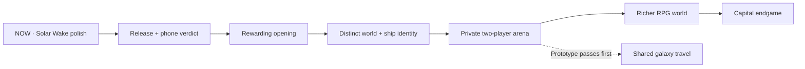

# Black Current: the living plan

The one backlog for every AI seat and every human working on this repo. Read it before you start; update it
before you stop.

## Master sequence — 2026-10-27

The central loop is **build → fight → recover something useful → refit → choose
a harder destination**. Mac owns design, direction, the phone/fun verdict and
release decisions. This is the only active game plan; generated diagrams and
the live task viewer read this file.

| Phase | Outcome | Gate before moving on |
| --- | --- | --- |
| 0. Finish Solar Wake | Faction, guardian, capture and refinement candidate | Rc.5 refinement 19/19; prior faction 29/29 and guardian 22/22 focused gates. Screenshots inspected. Full regression did not run; actual phone play pending. |
| 1. Land the release | One identifiable candidate on Pages and enjoyable on Mac’s phone | Publish on Mac’s word, verify live bytes, play the opening, fitting, navigation and guardian. Full regression status must stay explicit. |
| 2. Make the opening rewarding | Useful first upgrades, clear hull goals and readable fights | Time the first 15 minutes; an earned fitting within five minutes is a target. Tune income, loot and deaths. Phone FPS goals of 45–60 ordinary / 30 busy Medium remain unverified. |
| 3. Give space and ships identity | Distinct systems, coherent ship art, useful stations and meaningful roles | Continue selected-art integration, authored encounters and clear travel. Decide five versus eight hull paths before implementing specialisations. Preserve room for player designs. |
| 4. Prototype private co-op | Two pilots join one arena with a short room code | Prove two-player simulation, shared enemies, authoritative rewards and reconnects. No room service exists; persistent co-op rewards wait for save-safety checks. |
| 5. Deepen the RPG world | Named NPC jobs, exploration sites, companions and targeted equipment | Each activity has a readable goal, counterplay and useful reward. Improve existing quests and augments before adding mandatory systems. Expand co-op travel only after the arena prototype works. |
| 6. Earn the capital endgame | Roaming warlords, anomalies, distinct bosses and major ship investments | Capital fights must offer tactics and specific rewards. Add replay value and faction build paths without making difficulty only larger HP pools. |

### Visual route

**Release cut:** **2.11.0-rc.6 reliability**, token `20261027s60`, prepared
for Mac’s authorised push. Opening37/37, fitting34/34, novice fleet62/62 and
civilisation/new-campaign17/17 passed. The broad sweep was interrupted during
command4; remaining legacy checks have no final green verdict. Dock/apply,
fresh-campaign reload/save contamination and capped SWARM retention are
repaired. Full regression and actual phone performance remain pending.

**Published build:** **2.11.0-rc.5 · Solar Wake refinement** is published.
Source `56893b2`, Pages `1af67ed`, cache `20261027s59`. Refinement passed
19/19 and package/offline passed23/23; all52 changed public files matched
the reviewed package after the correct Pages commit reached built. Earlier
progression25/25, faction29/29 and guardian22/22 receipts retain their original
rc.2/3/4 versions. Full npm regression did not run; actual phone play remains
Mac’s verdict. The matching standalone HTML and capture guide are in Mac’s
Desktop trailer kit. Mac resumed with “forge on”; the regression/reliability
batch is closing at his usage boundary. Co-op remains a proposal, with no room service built.

### Co-op proposal — design only

- First slice: private two-player room, one arena, existing ships, one shared
  guardian, friendly fire off, personal loot and a simple revive. Four players
  is a later expansion, after frame/network measurements.
- Join flow: create room → share code → ready check → enter together → fight →
  leave with an explicit result. No public matchmaking or voice/chat is needed
  for this first slice.
- Proposed authority: a room service owns enemies, damage, pickups and reward
  claims; clients send input and display snapshots. This needs a technical
  spike: the present runtime has one global player and player/enemy bullet
  ownership. It is not already a network engine.
- Architecture gate: separate simulation from presentation, add player/team IDs,
  validate imported designs, and define reconnect and room-ending behaviour.
  Prototype persistent rewards only after duplicate-claim and dropped-connection
  cases pass. Room hosting, stack, cost and delivery time are still undecided.
- Persistent shared galaxy, trading and PvP stay outside the first prototype.
  This proposal authorises planning, not deployment of a multiplayer backend.

### What makes the game worth returning to

Visible ship growth, distinct fights, understandable next upgrades, memorable
places and a friend to share them with. A good trailer should show actual
building, actual combat and one striking guardian scene. Judge the first release
by playability and those concrete moments; commercial reach remains unproven.

Damage-triad multipliers, adjacency bonuses and a volatile hold remain optional
design proposals. They do not automatically enter the next build.

## Rules (every seat follows these)

1. **Follow Mac’s latest direction.** Work the backlog in priority order; keep each build batch bounded.
2. **One plan.** This file is the backlog. Dated docs (`PLAN_WEEKEND_BLITZ_*`, `HANDOFF_*`, `docs/research/*`)
   are history and sources, not plans (`PLAN_2026-08-17.md` and `PLAN_FPS_AND_FUN_2026-10-23.md` included). If you find a second to-do list, merge it here and say so in your commit.
3. **Delete finished work.** When an item is done, delete it from this file in the same commit that lands it.
   The receipt lives in the commit message, not here. Done items do not stay as ✅ lines.
4. **Done means witnessed.** You can delete an item only when the thing works in the running game (a screenshot
   or a witness script) and `npm test` is no worse than before. A green test alone is not done. Phone feel and fun
   are Mac's call. Mark phone-unchecked work `PHONE: pending`.
5. **Delete dead ideas too.** If Mac rejects an item, or the evidence kills it, delete it and put one line of
   why in the commit message.
6. **Keep it short.** Each item gets a name, what done looks like, and where it touches the code. No essays.
   Detail goes in code comments or a handoff.
7. **Order is priority.** Work top-down unless Mac says otherwise. Mac can reorder at any time.
8. **Claims carry a label.** Line counts and effort guesses are guesses (UNVERIFIED) until someone builds them.
9. **Laws still apply.** README §Laws, `GAME_VISION.md`, `CLAUDE.md`. Classic scripts only, guard with `typeof X`,
   never break the source-hash gates (`weapons.js` and the other original gun files stay byte-identical; patch them
   from another file).
10. **Keep live tasks current.** Update the table below at build milestones. Only one task is running; queued,
    blocked and awaiting Mac's test are distinct. Done carries evidence. The local task viewer reads this file,
    so never create a second progress database or mark planned work as completed.

## Live tasks

The live viewer reads the local working copy. A GitHub commit is a timestamped
snapshot of this table, not an automatic activity feed.

<!-- live-tasks:start -->
Project: Black Current
Focus: Close rc.6 publication and matching Desktop HTML, then stop at Mac’s usage boundary.
Updated: 2026-10-27T04:46:52+00:00

| ID | Status | Task | Evidence / next step |
| --- | --- | --- | --- |
| refinement-pass | review | Refine the playable opening, touch HUD and fitting feedback | rc.6: opening37/37, fitting34/34, novice62/62, campaign17/17 green. Broad sweep interrupted during command4; no full-suite green claim. Actual phone pending. Mac requested immediate release closure. |
| phone-verdict | review | Play the opening, fitting, wallet and travel on Mac’s actual phone | Published build is Solar Wake 2.11.0-rc.5; the local additions have focused browser witnesses. Actual FPS, touch feel and fun remain Mac’s verdict. |
| space-forge | review | Improve encounter readability and measured rendering cost | Local candidate: cache, fuller silhouettes, class/role/HP labels, lock/ram warnings, sector-exit markers and compact route card. 15/15 focused Firefox checks, 20 role/class combinations, screenshots inspected. Capital render 19.6 ms cached / 37.6 ms uncached. Full regression and real-phone FPS pending; published in rc.5. |
| audio-forge | review | Give weapons and combat cues a clearer sound mix | 15/15 focused Firefox/audio checks passed. Five families, longer capital envelope, actual engine-fire routing, stereo/distance, heartbeat, 200-call budget/cleanup, zero volume and Effects slider covered. Twelve WAVs and local listening page; phone settings screenshot inspected. Taste/phone/full regression pending; published in rc.5. |
| equipment-codex | review | Make equipment visually understandable and discoverable | Local guide: 167 starting entries, 92 weapon models, 32 traits; paged pictures, actual stats/fit/source, persistent collection and native shop handoff. 21/21 focused Firefox checks; six-metal purchase, refused-save rollback and trait reload passed. Desktop/phone screenshots inspected. Full regression and real phone pending; published in rc.5. |
| supply-loop | review | Give combat targeted rewards and stations limited specials | 27/27 focused Firefox checks. Four named commissions, one active and once-per-system rewards; three persisted specials per outer system, exact charges, one-copy stock, atomic rollback and native Apply. Continue location fixed; phone buttons and fitting guide witnessed. Full regression/real phone/balance pending; included in the published rc.5. |
| release-candidate | running | Published release; await Mac’s actual-phone verdict | Publishing authorised rc.6 cut, token20261027s60, plus matching Desktop HTML. Full regression incomplete. Verify live bytes before final link. |
| progression-census | review | Balance the rookie-to-capital climb from play evidence | Rc.2: native price/reward census; rookie income unchanged, Light 48–68, cruiser frame plus rank 720. Compact pictured progression, layout-preserving frame preview. 25/25 packaged/offline checks: earned six-metal purchase, training/frame save-failure rollback, both guns and biomass retained through reload. Timed play, balance and real phone pending; included in the published rc.5. |
| world-encounters | review | Give systems distinct faction encounters and threats | Rc.3 faction gate29/29:300 native models,3 styles,12 selected sprites, composition/steering/firing, phone warning repair. Rc.4 guardian gate22/22: orbital landscape, capital Solar Dreadnought,3 native phases, actual relic once, zero-progress rehearsal and exact save/actor/storage restoration, phone capture and offline art. Screenshots inspected. Full regression/actual phone pending. Published in rc.5. |
| hull-art-roles | queued | Build coherent ship art and role paths | Phase 5: select incoming art, witness fitting/flight scale, and settle five versus eight paths per frame before implementation. |
| coop-prototype | queued | Design a private two-player arena before shared galaxy co-op | Planning only: room codes, separate player ownership, authoritative simulation, reconnect and save/reward safety. No backend or room feature implemented. |
| capital-endgame | queued | Forge bosses, anomalies and capital objectives | Phase 6: readable counterplay, specific reward sources and canon NPC content. |
<!-- live-tasks:end -->

## Deploy (main is NOT the live site)
GitHub Pages serves the **`gh-pages`** branch, not `main`. Pushing `main` changes nothing Mac can see.
Prepare the selected-source candidate with `python3 scripts/build-candidate.py`.
This includes tracked assets and referenced JS/CSS from the working tree while
excluding unselected incoming art. Review `shots/release-candidate/package.json`
and run `npm run test:candidate` with muted audio before a release decision.
To publish that reviewed candidate: copy `dist/release-candidate/` over a `gh-pages` worktree → commit
"Publish ..." → push `gh-pages` → wait for `gh api repos/Lycheetah/black-current/pages/builds/latest` to say
`built` → check the live `play/` page shows the new `v=` cache token. Publish only on Mac's word.

## Standing rulings from Mac
- **Latest playtest (2026-10-26):** opening sectors 0,2 and 0,3 must be beatable with a three-gun rookie; expand normal sector grids by three rings. Enemy roles must look different. Reduce excessive equipment drops and check actual weapon DPS. Keep entry fitting obvious; premades are valuable.
- **Current opening/refit ruling (2026-10-26):** build-first, premades optional; starter frigates have ten sections, two supplied guns and a four-weapon cap. Ordinary weapons use one hardware price. Owned fittings may be swapped in the field; new purchases and structural rebuilding use stations. Retire obsolete vow overlays and favour polishing existing systems. Show Metal and Biomass together.
- **Latest ruling:** retire the old freeform fitting screen; modular is the visible fitting screen. Reset old development campaigns once for the new novice fleet (Mac, current session).
- **"Modular ships is the way"** (Mac, 2026-10-25): modular is where new depth and art go first.
- Test a build free with **Test flight · free** (modular yard) or **HOLO TEST · free** (classic yard, desktop).
- Test any build with `?forge-test` (gives 999,999 metal).

## Canon (Mac's Sovereign Eclipse lore, the game's own lineage)
`docs/canon/` holds Mac's canon: the **Master Canon Bible** (canonical; it contains the full Pantheon Codex),
the **15-civilisation Pantheon** and the **270 faction hulls**. `js/canon.js` is the same canon as game data:
15 civilisations (doctrine, fleet DNA, favoured weapon, relic, frontier), the 18-class ladder
Pod → Starter Frigate → … → Dreadnought → Carrier → Titan, 270 hull names, and the Five Depths
(Naraka · Erebos · Aion · Chaos Cradle · Deep Current). Canon wins naming disputes. New factions, enemies,
stations and hulls take their names and look from it.

## North star (Mac, 2026-10-25)
"Focus on making the main game fucking epic": ships buildable to **capital proportions**, **bases** you build,
**many kinds of enemies**, a **deep space with anomalies**, and **EVE-like quests and bounties with NPCs to talk
to**. Mining and industry are parked: build them only if players ask for them.

## Backlog (top = next)

1. **Mac’s phone verdict and any remaining play blockers.** Solar Wake2.11.0-rc.5 is live: source `56893b2`, Pages `1af67ed`, token `20261027s59`. Refinement19/19 and package/offline23/23 passed; all52 changed public release files match. Try the two-gun start, fitting inspection, wallet, journal/quest routes, station purchases and guardian rehearsal. Actual touch, sustained FPS and fun remain Mac’s verdict. Full npm regression did not run; run it next session and fix reproducible failures before new systems.

2. **The space experience: witnessed encounters, scale and polish.** Capture and inspect novice, skirmish and capital-scale scenes at controlled zoom before changing them. Make enemy silhouettes/roles, threat warnings, station scale and navigation readable. Measure enemy counts, hit rates, time-to-kill, income and frame time across representative sectors. Enemy progression needs recognisable behaviours and encounters, not just bigger HP numbers.  Profile a representative fight and fix the largest measured frame-time cost. Refine captain/augment/journal flows before adding more progression layers. A focused sound pass follows: distinct weapon-family voices and impacts, bounded firing layers, clearer warning/pickup/docking cues, ambient beds and usable volume controls. Improve or consolidate the current audio engine where that suffices; a wholesale replacement is not assumed. Mac’s latest direction: finish, explain and polish existing systems before expanding them.

   Local candidate: bounded static hull cache, fuller role silhouettes, class/role/HP contact labels, explicit lock/ram warnings, cardinal exit/landmark markers and compact phone route controls. `npm run test:space`: 15 focused Firefox checks; twenty role/class combinations compile. Final same-scene capital render cost: 19.6 ms cached / 37.6 ms uncached, 30 samples each. Screenshots inspected under `shots/space-experience/candidate/`. Full regression, actual phone FPS, encounter balance and sound remain pending; no commit/push/publication yet. PHONE: pending.

   Audio candidate: filtered family/archetype/size voices, bounded legacy pops, six-weapon/eight-ordinary/ten-total managed voices, cue headroom, zoom-independent distance audio, temporary music ducking and zero-volume allocation guard. `npm run test:audio`: 15 checks; twelve offline WAVs and `shots/audio-forge/listen.html`. Spatial placement, actual engine fire, heartbeat, cleanup and native Effects control passed. Existing engine already exposes `window.engine`; lexical guards improve robustness rather than restore a missing feature. Listening quality, real-phone audio and full regression pending. Local only.

3. **Equipment Codex, station stock and named loot.** Mac’s latest idea: a discovered-module/gun collection book, with varied stock at stations and variants recovered from enemies. Record discovered models, silhouettes for unknown entries, actual stats, compatible mounts and where they are found. Stations and enemies draw from the same catalogue and feed the existing modular hold. Roll bounded traits within weapon size and danger tiers; keep ordinary novice purchases accessible. This follows the witnessed space-experience pass. Reliable faction-quest rewards complement rarer drops; outer station variants rotate on a persisted schedule, never by reopening the menu. Keep ordinary rookie stock available. Evidence and source citations: `docs/research/LOOT_PROGRESSION_2026-10-26.md`.

   Codex local candidate: 167 starting entries, including 92 weapon models and 32 recovery traits; paged pictured cards, clear fitting/stat/source details, persistent collection metadata and native shop handoff. Pause/station/fitting doors use one guide. `npm run test:codex`: 21 focused Firefox checks; six-metal native purchase, refused-save rollback, trait/reload history and modal/phone geometry passed. Screenshots inspected in `shots/equipment-codex/`. Full regression and real-phone feel pending. Local only; no commit/push/publication.

   Supply local candidate (2026-10-27): four named commissions in `contracts.requisitions`, one active, exact physical rewards and once-per-system claims. Outer systems have three limited existing-trait specials in `quartermaster.markets`; a saved 12-hour period and sold counts prevent menu rerolls. Rookie ordinary stock remains available. Native hold/fitting and atomic transactions remain authoritative; the old vendor panels are retired. Continue preserves a valid saved outer location. `npm run test:supply`: 27 focused checks, including real kills, practice exclusion, exact charge/copy, rollback, native callbacks, reload, clock reversal and phone controls. Screenshots inspected under `shots/quartermaster/`. Full regression, actual phone feel and economic balance pending. Next: consolidate this release candidate before new features.

   **Named loot with traits:** Elites, outposts, targeted missions and bosses can provide a named
   module with a strong upside and a real downside (e.g. Overclocked Magnetron: +40% beam range, +15% recoil).
   Socketed in the yard. This absorbs the old "EVE module inventory" item: one inventory, not two.
   Touches: `loot.js`, `modular-ships.js`, `modular-yard.js`.

4. **Opening balance and direction.** Two supplied guns are the opening change; income and weapon damage remain unchanged. Measure first real fights and time to the next earned upgrade on Mac’s phone. Keep the dockkeeper recovery job and physical-gun reward reachable. Early play should show one useful next action, with hull milestones visible when wanted.

5. **Weapon and defence balance.** Preserve a large weapon catalogue and meaningful size/cadence choices. Measure mass, income, fitting limits and armour/shield trade-offs across early zones; avoid both an unusably weak opening and the old zone-three power spike. Functional armour may share a section with its gun while paying its real price and obeying mount limits.

6. **Module and gun art pass.** Mac: modular "leaves us such an easier room to make sick art for the modules and
   the guns". Each section, clip-on, gear and turret gets a top-down sprite in `topdown-kit.js` style, one look,
   readable at phone zoom. Carried over from the yard skin (2026-10-25): put that art on the yard's part and
   factory cards, and animate the top stat pills on every change.

7. **Reactors and energy batteries, after the fundamentals.** Core output limits fitting; stored energy sustains temporary active boosts. Explore fusion reactors and capacitor choices once the basic fitting and early-game loop feel good. Existing passive/active systems remain the baseline; sensors are deferred until they have useful gameplay.

8. **Hull specialisation pathways.** Each of the six frames (frigate, cruiser, battleship, capital, supercapital, titan) branches into role paths (EVE-style: interceptor, assault, logistics, ewar, carrier, siege and so on). Mac: *"specialization pathways for each of those is a good variety right but 5 eight classes"*, so confirm with him whether that means 5 paths per class or 8. Make it data in `js/modular-ships.js` next to `HULLS`, priced on the shipwright ladder, and balanced on the `HULL_LADDER` net (never strictly stronger).

9. **Hired escorts + a wider galaxy.** The civilisation start landed (15 canon civilisations, each with its own
   calm home that becomes your anchorage; `js/civilisations.js`, witness `witness-civilisations.mjs`). Next: a
   hireable NPC escort, a healer frigate first, as the solo answer to zones built for groups (Mac: "hire a healer
   mercenary ship or frigate solo"); then more zones on the galaxy map. Multiplayer and PvP need a server later;
   the save already records `civ` and `civHome` per run.

10. **Quests, bounties and NPCs (EVE-style agents).** Every NPC starbase has agents with a name, a civilisation
   and a standing with you. They offer missions (kill, escort, courier, scan an anomaly, hunt a named target) with
   a briefing, objectives on the map and a reward in metal, parts and standing. A bounty board posts named
   warlords and demons with a price that grows the longer they roam. Missions are data in one table, not code.

11. **Deep space and anomalies.** Past the charted zones, Depth rises: scan for anomalies (derelicts, rifts,
   combat sites, relic caches, demon nests), each a short authored encounter with a payout and a risk. Feeds agent missions and the abyssal hold.

12. **Jump gates + NPC starbases (the long road).**
   - *Found gates:* a few fixed gates already in the galaxy link distant systems (one-way until you light the
     far side).
   - *Built gates:* you build a gate pair (large metal sink, late game), one at each end, to make your own
     shortcut home. This is the answer to "going back to base is a slog".
   - *NPC starbases:* one per canon civilisation as you push out, dressed in its fleet DNA, selling its favoured
     weapon family. Trade, refit (docked price), contracts,
     rumours of warlords. Some are hostile fortresses.
   - *Our bases scale out:* station size, defences and services grow with depth (Naraka → Erebos → Aion →
     Chaos Cradle → Deep Current), so the deep frontier has to be earned and its stations feel huge.
   Sol's proposed order: NPC starbases (content you meet) → found gates → built gates → base scaling. Plan
   this with Mac before building; each step is its own batch. Touches: `galaxy.js`, `hubs.js`, `travel.js`,
   `sectors.js`.

13. **Damage triad.** Kinetic/rail do ×2 to shields and ×0.5 to plated hull. Beam does ×0.5 to shields and ×1.5 to
   hull. Ordnance/missile does flat damage but has 3× the chance to shear off nodes. Uses `arsenal.GUNS[id].family`.
   Done when a shielded elite visibly needs kinetic to break and beam to finish. The holo bay's DPS readout is
   the witness. Touches: a patch over the damage path, never `weapons.js` directly.

14. **Chassis tiers on the canon ladder + the Goliath berth.** The 18 canon classes (Pod → Titan) are the
   chassis ladder. Each tier gets its own grid, slots, power, clip-on limit and look, unlocked by mass and
   Shipwright rank. A carrier gets extra bay mounts, a capital gets silo banks and a built-in command post.
   Your civilisation choice names your hulls (e.g. Savanah: Green Seed, Eye Knife, Harpy Claw, Watcher Dread).
   A shadowed **PROJECT GOLIATH** Titan under scaffolding at Asterion Forge (99,000 metal + 3 warlord cores)
   is visible from day 1 as the long goal. Touches: `modular-ships.js HULLS`, `canon.js`, `topdown-kit.js`.

15. **Adjacency bonuses.** Neighbouring sections buff each other (power next to a gun deck: faster traverse and
   fire; shield next to the core or a bay: that node resists damage; engine next to a nacelle: more acceleration).
   Shown live in the yard. Touches: `modular-ships.js compile`.

16. **Abyssal hold (push your luck).** The deeper Depths (Chaos Cradle, Deep Current) pay 3–5× metal into an unbanked **volatile hold** that only
   banks at a hub, a forward dock or an NPC starbase. Death leaves it at your wreck as a recovery beacon. This is
   risk, not guilt: the wreck always waits for you. Touches: `hubs.js`, `galaxy.js`, `wreck.js`.

17. **Roaming warlords.** 6 named, persistent pirate bosses with bounty cards, a sector-entry klaxon and a radio
    line, and a bounty that grows when they beat you. Each drops a warlord core (feeds Goliath).
    Touches: `bosses.js`, `galaxy.js`, `contracts.js`.
   Warlords are canon figures from the 15 civilisations (Chaos, Cosmic Darkness, Blackhole first), flying their
   faction's Dreadnought/Titan hulls.

18. **Space demons.** Mac: "this game should have space demons". Naraka (the inhabited threshold) and the Chaos
   Cradle are their natural home in canon. Mac is sending the list. Skeleton each one into `canon.js`-style data
   first, then build the fight.

19. **Enemies hunt fighters.** Bay fighters are only hit by stray fire. Some enemies should target drones on
    purpose. Touches: `ai.js` via a patch, `roles.js`.

20. **Fix it button** for "fitting limit exceeded". It removes the cheapest parts until the build fits.

21. **Unify the legacy research screen.** The new visual Equipment shop has family, size and ownership filters. Retire the separate legacy armoury presentation once its fire-control/research flow and its witness have migrated; keep the underlying purchase and ownership implementation.

22. **Red tests that were already failing before 2026-10-25.** galaxy ring-1 "bot never dies" (stochastic,
    deaths 0.3) and hubs "structures and metal survive a reload". Both stop `npm test` before skin/hubs/roles run.

## Sources
- `docs/canon/`: Mac's Sovereign Eclipse canon (see Canon above). `js/canon.js` is its data form.
- `docs/research/RETENTION_DOSSIER_FOR_SOL_OPUS.md`: a Gemini research pass on Starsector, Space Rangers 2,
  Cosmoteer, Dredge and EVE (items 3–8 come from it; its line counts are UNVERIFIED).
- `HANDOFF_2026-10-25_menus_loot.md`: local only, the session receipts behind the top-down hulls and clip-ons.
