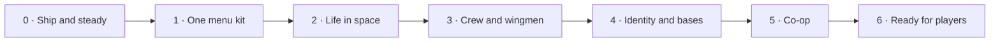

# Black Current: the master plan

The one plan for every AI seat and every human working on this repo: a single
route, worked top-down. Read it before you start; update it before you stop.

## The master route · Route 2 "The living current" (2026-10-29)

The central loop is still **build → fight → recover something useful → refit → choose
a harder destination**. Route 1 (scale, arsenal, climb, interface, wide dark, capital
endgame) shipped as **2.12.0-rc.14**. Its receipts live in the CHANGELOG and git history.
Route 2 makes the Current feel **alive and shared**: allies, people with jobs, ships with
identity, a home you build, a friend in the fight, and a release strangers can pick up.

Mac owns design, direction, the phone/fun verdict and release decisions. This is the
**only** game plan: one route, worked top-down. **Every stage ends in a publishable
candidate.** We publish small drops (one per stage or two) on Mac's word, so feedback
stays fresh. The table is what `scripts/render-roadmap.py` draws; the stage notes below
are the working list.

| Stage | Outcome | Done when |
| --- | --- | --- |
| 0. Ship and steady | rc.14 live, tests on every PR, a suite you can trust | rc.14 is on Pages. The PR workflow runs the `ci` witness group. The full suite is ≥ 90% green, with every remaining red named as a Mac-device check. The biggest measured cost in a titan fight is fixed. |
| 1. One menu kit | Every screen in one visual style, one station hub, a real map | One shared component kit (panel, tabs, cards, lists, buttons) drives title, pause, station, shop, codex, captain, journal, hold and settings. Pause shrinks to essentials with no duplicate doors. Station specials and the salvage hold are rebuilt. The sector and galaxy charts become a zoomable map. Desktop and phone captures are reviewed by Mac. |
| 2. Life in space | Story, people, jobs and places worth the trip | Canon questlines for the civilisations and the Five Depths, with named NPCs. Station contacts offer escort, defence, courier and bounty jobs with routes. Reputation per civilisation. Expeditions, the Grave Choir, jelly shoals, boss arenas and salvage tides each get a reason and a reward. |
| 3. Crew and wingmen | Captain, crew and ship roles you choose between | Talents, AI cores and augments become real choices. Drone bays, siphons, wing docks and menders become playstyles. Hire 1–3 wingmen from saved designs, with orders, roles and rebuild. Ships and shots carry owner/team ids. |
| 4. Identity and bases | Five hull paths, signatures, a home you build | Interceptor, assault, logistics, carrier and siege per frame. Civilisation liveries and clip-ons. Module art from Antigravity's lane. Base modules (refinery, berth, hangar, defence grid) with raid warnings. The titan works as a mobile base. |
| 5. Co-op | Two friends, one fight | Room code → peer-to-peer WebRTC, with the host's browser running the fight. One shared guardian arena, friendly fire off, personal loot, revive, and a safe leave or reconnect, proven across two networks. |
| 6. Ready for players | v3.0 for strangers | Onboarding covers the new systems. Mac's phone pass is done. Trailer captured. itch.io page with the standalone download. 3.0.0 published. |

### Why this order

- **Trust first.** 31 of 54 witnesses were red, mostly stale, so the suite couldn't say "nothing broke". Small drops need a suite and CI that mean something.
- **Menus next (Mac, 2026-10-29: the menus look rough).** The rc.14 audit found:
  - about four visual styles;
  - a 14-button pause menu with duplicate doors;
  - a cramped 19×19 sector grid and an empty-looking galaxy chart;
  - a blank Station specials page;
  - an old-style salvage popup.
  Every later stage adds screens, so the kit has to exist first.
- **Then flesh out what already exists (Mac picked all four areas).** Story and canon, captain and crew, ship roles, events and places are all half-built. Making them real beats adding new systems beside them.
- **Wingmen ride with crew and roles.** Wing docks and menders already exist as parts. Wingmen and team ids grow out of them, and team ids are half the co-op refactor.
- **Identity and bases before co-op.** Paths and bases give two players something to bring and somewhere to return to.
- **Ready for players last.** Onboarding, trailer and store page describe a finished feature set.

### Decisions in force

Still in force from Route 1:
1. The six core files are open to edit, under behaviour witnesses.
2. Saves are migrated, never reset.
3. `art/` is used first; Antigravity keeps the module and cosmetic art lane.
4. Threat stays fixed by place and never reads the player's power.

New, Mac, 2026-10-29:
5. **Small drops.** Publish rc.14, then a candidate after every stage or two, on Mac's word.
6. **Five hull paths per frame:** interceptor, assault, logistics, carrier, siege.
7. **Co-op is peer-to-peer and host-authoritative.** The host's browser runs the fight and the guest sends input. No game server.
   - Signalling for the first slice uses a free relay (PeerJS cloud). That is a third-party dependency; Mac confirms it before Stage 5 ships.

### Stage notes (the working list)

**0 · Ship and steady**
- ~~Publish rc.14~~ Done 2026-10-29.
- **CI:** `.github/workflows/test.yml` runs `node scripts/regression.mjs --retry ci` in Firefox on every PR.
  - **Blocked:** GitHub Actions never starts a runner on this repo (runner_id 0, about 3 s). The existing `Publish Black Current` workflow on `main` fails the same way. Mac: check Settings → Billing and repo Settings → Actions.
- **Test debt:** work the red witnesses.
  - Update the stale ones.
  - Retire witnesses whose subject was removed, with one line each in the commit.
  - Name the Mac-device-only checks.
- **Performance:** profile a danger-20 titan fight (`scripts/attrib-render-passes.mjs`, `js/render-budget.js`) and fix the biggest measured cost.

**1 · One menu kit**
- **One component kit** (`css/ui-kit.css` plus small DOM helpers): panel, header, tabs, card grid, list row, stat chip, primary/secondary button, empty state. One type scale and one palette.
- **Screens move onto the kit:** title, new pilot, pause, settings, how to play, station hub, shop, specials, codex, captain/journal, salvage hold, upgrades.
- **Pause:** resume, ship, station-or-chart, journal, settings, quit. No duplicate doors.
- **Station hub:** one screen with your ship plus service cards. Captain, training and upgrades merge into one "Captain & ship" area. Station specials gets real stock cards. The salvage hold becomes a hub card.
- **Map:**
  - one zoomable map with system and galaxy layers;
  - sectors drawn by band colour, with routes and icons (stations, derelicts, citadels, warlords);
  - tap to route; phone pinch and drag.
- **Proof:** `witness-menu-kit.mjs` (every screen opens, one style token set, no overflow on desktop or 390×844). Contact sheets for Mac.

**2 · Life in space**
- **Story and canon:**
  - a questline per civilisation, starting with five;
  - Five Depths story beats;
  - named NPCs from `docs/canon/` (`js/canon.js`).
  The journal grows main / faction / depth tabs. Continues the `first-expedition.js` pattern.
- **Jobs:** contacts in the station hub offer escort, station defence, courier and bounty jobs, as contract kinds routed through `travel.js`.
- **Reputation** per civilisation opens `quartermaster.js` stock, commissions and liveries.
- **Events and places:**
  - `expeditions.js`, the Grave Choir (rescale onto the threat ladder), `jelly-shoals.js`, `boss-scenes.js` and `salvage-tides.js` each get a clear hook, map marker and specific reward;
  - more system rules.
- **Proof:** `witness-life.mjs`.

**3 · Crew and wingmen**
- **Captain:** `pilot.js` talents and training, `captain-talents.js` and AI cores become build choices with visible trade-offs, plus augments slots.
- **Crew:** a crew roster with traits (from vows/crews) that changes how the ship plays.
- **Ship roles:** `roles.js` drone bays, siphons, wing docks and menders each get a clear playstyle, upgrade path and counter.
- **Wingmen:**
  - a `wingmen` save doc;
  - modular designs compiled with `modularShips.compile`, scaled by `tuning.SIZE`;
  - orders on keys 5–8 and phone buttons;
  - rebuild at stations.
- **Team ids** on ships and projectiles, so kills, loot and contracts attribute correctly.
- **Proof:** `witness-crew.mjs` and `witness-wingmen.mjs`.

**4 · Identity and bases**
- **Hull paths:** bought from the Shipwright and stored per frame. Each changes a few `tuning` multipliers, shown on frame cards.
- **Civilisation signatures** through `ship-identity.js` and `faction-art.js`. Module art from `art/review/` → `art/keyed/`, coordinated with Antigravity.
- **Bases:**
  - `hubs.js` KINDS gain refinery, berth, hangar and defence grid;
  - a base panel;
  - raid warnings.
- **Titan services:** field refit and wingman relaunch.
- **Proof:** `witness-identity-paths.mjs` and `witness-bases.mjs`.

**5 · Co-op** (design notes below)
- Refactor the engine to `engine.players[]`, with `engine.player` kept as the local alias.
- A WebRTC data channel. The host sends snapshots at about 15 Hz and the guest sends input at 30 Hz.
- First slice: one guardian arena, personal loot, revive, a 30 s reconnect.
- Mac confirms the PeerJS signalling relay before this ships.
- **Proof:** `witness-coop.mjs`, with two browser contexts.

**6 · Ready for players**
- Onboarding cards for the new systems.
- Mac's phone pass.
- Trailer from `docs/TRAILER_CAPTURE.md`.
- itch.io page and standalone build.
- 3.0.0.

### Parked (not deleted)
- **Persistent shared galaxy, trading, PvP:** only after co-op works.
- **Optional mechanics:** adjacency bonuses, a volatile hold, a fitting-reduction preview. Never add these by implication.
- **Mining and industry:** only if players ask.

### Co-op design (Stage 5)

- **First slice:** a private two-player room, one arena, existing ships, one shared
  guardian, friendly fire off, personal loot and a simple revive. Four players is a
  later expansion, after frame and network measurements.
- **Join flow:** create room → share code → ready check → enter together → fight →
  leave with an explicit result. No public matchmaking or voice/chat.
- **Authority:** the host's browser simulates enemies, damage, pickups and reward
  claims. The guest sends input and draws snapshots. Each player's own save records
  only their own loot. Duplicate-claim and dropped-connection cases must pass before
  rewards persist.
- **Architecture gate:**
  - separate simulation from presentation;
  - player/team ids (started in Stage 1);
  - validate the guest's imported design;
  - defined reconnect and room-ending behaviour.

### What makes the game worth returning to

Visible ship growth, distinct fights, understandable next upgrades, memorable
places and a friend to share them with. A good trailer should show actual
building, actual combat and one striking guardian scene. Judge the first release
by playability and those concrete moments; commercial reach remains unproven.

## Rules (every seat follows these)

1. **Follow Mac’s latest direction.** Work the route in stage order; keep each build batch bounded.
2. **One plan.** This file is the master route. Dated docs (`PLAN_WEEKEND_BLITZ_*`, `HANDOFF_*`, `docs/research/*`)
   are history and sources, not plans (`PLAN_2026-08-17.md` and `PLAN_FPS_AND_FUN_2026-10-23.md` included). If you find a second to-do list, merge it here and say so in your commit.
3. **Delete finished work.** When an item is done, delete it from this file in the same commit that lands it.
   The receipt lives in the commit message, not here. Done items do not stay as ✅ lines.
4. **Done means witnessed.** You can delete an item only when the thing works in the running game (a screenshot
   or a witness script) and `npm test` is no worse than before. A green test alone is not done. Phone feel and fun
   are Mac's call. Mark phone-unchecked work `PHONE: pending`.
5. **Delete dead ideas too.** If Mac rejects an item, or the evidence kills it, delete it and put one line of
   why in the commit message.
6. **Keep it short.** Each item gets a name, what done looks like, and where it touches the code. No essays.
   Detail goes in code comments or a handoff.
7. **Order is priority.** Work top-down unless Mac says otherwise. Mac can reorder at any time.
8. **Claims carry a label.** Line counts and effort guesses are guesses (UNVERIFIED) until someone builds them.
9. **Laws still apply.** README §Laws, `GAME_VISION.md`, `CLAUDE.md`. Classic scripts only, guard with `typeof X`.
   The six core files (`engine.js`, `hardpoints.js`, `fleet.js`, `weapons.js`, `progression.js`, `shipyard-ui.js`)
   may be edited directly from Stage 0 on; behaviour witnesses, not byte hashes, protect them.
10. **Keep live tasks current.** Update the table below at build milestones. Only one task is running; queued,
    blocked and awaiting Mac's test are distinct. Done carries evidence. The local task viewer reads this file,
    so never create a second progress database or mark planned work as completed.

## Live tasks

The live viewer reads the local working copy. A GitHub commit is a timestamped
snapshot of this table, not an automatic activity feed.

<!-- live-tasks:start -->
Project: Black Current
Published: 2.12.0-rc.14 · Master route (preview) · live on Pages (gh-pages 07870cb, cache 20261028s69)
Candidate: none
Focus: Route 2 · Stage 0 Ship and steady is running (test debt, performance); Stage 1 One menu kit is next (Mac: menus look rough). rc.14 verdict is open.
Updated: 2026-10-29T10:00:00+00:00

| ID | Status | Task | Evidence / next step |
| --- | --- | --- | --- |
| stage-0-ship | running | rc.14 live, CI on PRs, a trustworthy suite, titan-fight performance | rc.14 published (gh-pages 07870cb). CI workflow added but **blocked**: Actions never starts a runner on this repo; Mac to check billing/Actions settings. Suite 34/46 green (main/rc.13: 17/48); `ci` gate = 34 witnesses. Real bugs fixed: warlords erased jelly shoals; New campaign → Build skipped the build; boss rehearsal wrote an empty `discoveries` field. 8 witnesses of removed UI retired (scripts/retired/README.md). Named debt, all red on main too: faction-fleets (enemy-wings re-roles formations), first-expedition (old armory licences, guard flake), gentle (bot sim never reaches danger 4), hangar-ui (panel scroll, capital price label), hubs ("This is a hub already"), phone-fitting (flow stall), refinement (draft preview), rookie-balance (elite sample at its 40 bound), sprites, vitals (320×568), site (needs .site-build on 8812), release-candidate (Mac's untracked incoming art). Next: titan-fight performance. |
| stage-1-menus | running | One menu kit, station hub, pause, map | Kit landed (75b4812): css/ui-kit.css + js/ui-kit.js frame every service panel; pause regrouped into objective, Resume, six pictured tiles, extras and a quiet quit; `witness-menu-kit` (12 checks) in the gate. rc.15 candidate built (15cdd42), awaiting Mac's word to publish. Next: zoomable sector map replacing the 19×19 label grid and galaxy dots; station specials empty state; hold as a hub card; contact sheets for Mac. |
| stage-2-life | queued | Story and canon, jobs, reputation, events and places | Civilisation questlines, NPC jobs, reputation, every event with a hook and reward; `witness-life`. |
| stage-3-crew | queued | Captain/crew choices, ship-role playstyles, wingmen, team ids | `witness-crew`, `witness-wingmen`. |
| stage-4-identity | queued | Five hull paths, signatures, module art, bases, titan services | `witness-identity-paths`, `witness-bases`. |
| stage-5-coop | queued | Two-player peer-to-peer guardian fight | `engine.players[]`, WebRTC host authority; Mac confirms the PeerJS relay; `witness-coop`. |
| stage-6-players | queued | v3.0 for strangers | Onboarding, phone pass, trailer, itch.io, 3.0.0. |
| rc14-verdict | review | Mac plays rc.14 (desktop and phone) | Live at lycheetah.github.io/black-current/play/. Judge framing, pace, guns, the 17.6 h climb model, menus and FPS. Every number is one line in `js/tuning.js`. |
<!-- live-tasks:end -->

## Art library (`art/`, use before commissioning)

| Folder | Holds | Live now | Stage |
| --- | --- | --- | --- |
| `keyed/modules/`, `sliced/modules/` | 215 module and turret pieces (`manifest.json`) | Fitting art | 2, 4 |
| `keyed/sections/` | 10 modular hull tiles | Player hulls | 1 |
| `keyed/ships/`, `sliced/ships/` | 36 whole-ship sprites, Asterion and alien/precursor | Partly | 1 (enemy pools) |
| `keyed/enemy-ships/` | 17 enemy hulls | Partly | 1 |
| `keyed/hostiles/` | Hostile fleet sheet (`hostile-kit.json`) | Enemy skins | 1 |
| `keyed/turrets/`, `light_guns/`, `heavy_guns/` | Turret and gun art | Partly | 2 |
| `keyed/precursor_weapons/`, `alien_weapons/` | Solar lance, tachyon driver, bio dart, spore mortar | Not yet | 2 |
| `keyed/alien_blocks/`, `precursor_blocks/`, `armor/` | Carapace, heart, rib cage, keel, solar citadel, citadel slab | Not yet | 5, 6 |
| `keyed/structures/`, `keyed/world/` | Refit station, solar ring | Stations, boss arena | 5 |
| `concepts/`, `contact_*.png` | Concept sheets and contact sheets | Reference | — |

`faction-kit.json`, `hostile-kit.json` and `world-kit.json` select assets for the game.
Incoming art stays preserved; accepted pieces get manifest rows.

## Deploy (main is NOT the live site)
GitHub Pages serves the **`gh-pages`** branch, not `main`. Pushing `main` changes nothing Mac can see.
Prepare the selected-source candidate with `python3 scripts/build-candidate.py`.
This includes tracked assets and referenced JS/CSS from the working tree while
excluding unselected incoming art. Review `shots/release-candidate/package.json`
and run `npm run test:candidate` with muted audio before a release decision.
To publish that reviewed candidate: copy `dist/release-candidate/` over a `gh-pages` worktree → commit
"Publish ..." → push `gh-pages` → wait for `gh api repos/Lycheetah/black-current/pages/builds/latest` to say
`built` → check the live `play/` page shows the new `v=` cache token. Publish only on Mac's word.

## Standing rulings from Mac
- **Modular stays (latest):** use the original large node ships as silhouette references for modular capitals. Decompose bridge, keel, bow, armour, engines, hangars and batteries into coherent top-down parts. Weapon access and phone blockers come first; any later living uniques share the existing hangar/save infrastructure.
- **Latest playtest (2026-10-26):** opening sectors 0,2 and 0,3 must be beatable with a three-gun rookie; expand normal sector grids by three rings. Enemy roles must look different. Reduce excessive equipment drops and check actual weapon DPS. Keep entry fitting obvious; premades are valuable.
- **Current opening/refit ruling (2026-10-26):** build-first, premades optional; starter frigates have ten sections, two supplied guns and a four-weapon cap. Ordinary weapons use one hardware price. Owned fittings may be swapped in the field; new purchases and structural rebuilding use stations. Retire obsolete vow overlays and favour polishing existing systems. Show Metal and Biomass together.
- **Latest ruling:** retire the old freeform fitting screen; modular is the visible fitting screen. Reset old development campaigns once for the new novice fleet (Mac, current session).
- **"Modular ships is the way"** (Mac, 2026-10-25): modular is where new depth and art go first.
- Test a build free with **Test flight · free** (modular yard) or **HOLO TEST · free** (classic yard, desktop).
- Test any build with `?forge-test` (gives 999,999 metal).

## Canon (Mac's Sovereign Eclipse lore, the game's own lineage)
`docs/canon/` holds Mac's canon: the **Master Canon Bible** (canonical; it contains the full Pantheon Codex),
the **15-civilisation Pantheon** and the **270 faction hulls**. `js/canon.js` is the same canon as game data:
15 civilisations (doctrine, fleet DNA, favoured weapon, relic, frontier), the 18-class ladder
Pod → Starter Frigate → … → Dreadnought → Carrier → Titan, 270 hull names, and the Five Depths
(Naraka · Erebos · Aion · Chaos Cradle · Deep Current). Canon wins naming disputes. New factions, enemies,
stations and hulls take their names and look from it.

## North star (Mac, 2026-10-25)
"Focus on making the main game fucking epic": ships buildable to **capital proportions**, **bases** you build,
**many kinds of enemies**, a **deep space with anomalies**, and **EVE-like quests and bounties with NPCs to talk
to**. Mining and industry are parked: build them only if players ask for them.

## Sources
- `docs/canon/`: Mac's Sovereign Eclipse canon (see Canon above). `js/canon.js` is its data form.
- `docs/research/RETENTION_DOSSIER_FOR_SOL_OPUS.md`: a Gemini research pass on Starsector, Space Rangers 2,
  Cosmoteer, Dredge and EVE (historical design input; its line counts are UNVERIFIED).
- `HANDOFF_2026-10-25_menus_loot.md`: local only, the session receipts behind the top-down hulls and clip-ons.
