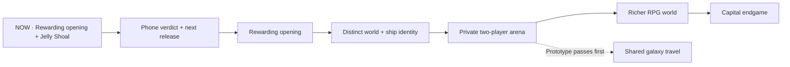

# Black Current: the living plan

The one backlog for every AI seat and every human working on this repo. Read it before you start; update it
before you stop.

## Master sequence — 2026-10-28

The central loop is **build → fight → recover something useful → refit → choose
a harder destination**. Mac owns design, direction, the phone/fun verdict and
release decisions. This is the only active game plan; generated diagrams and
the live task viewer read this file.

| Phase | Outcome | Gate before moving on |
| --- | --- | --- |
| 0. Forge Hostile Current | Coherent enemies, ranged fights, clear weapon stats and optional lock | rc.10 has31/31 combat/offline and31/31 reward checks; phone/fleet captures inspected. Actual phone and full regression pending. |
| 1. Land the release | One identifiable candidate on Pages and enjoyable on Mac’s phone | Publish on Mac’s word, verify live bytes, play the opening, fitting, navigation and guardian. Full regression status must stay explicit. |
| 2. Make the opening rewarding | Useful first upgrades, clear hull goals and readable fights | Time the first 15 minutes; an earned fitting within five minutes is a target. Tune income, loot and deaths. Phone FPS goals of 45–60 ordinary / 30 busy Medium remain unverified. |
| 3. Give space and ships identity | Distinct systems, coherent ship art, useful stations and meaningful roles | Continue selected-art integration, authored encounters and clear travel. Decide five versus eight hull paths before implementing specialisations. Preserve room for player designs. |
| 4. Prototype private co-op | Two pilots join one arena with a short room code | Prove two-player simulation, shared enemies, authoritative rewards and reconnects. No room service exists; persistent co-op rewards wait for save-safety checks. |
| 5. Deepen the RPG world | Named NPC jobs, exploration sites, companions and targeted equipment | Each activity has a readable goal, counterplay and useful reward. Improve existing quests and augments before adding mandatory systems. Expand co-op travel only after the arena prototype works. |
| 6. Earn the capital endgame | Roaming warlords, anomalies, distinct bosses and major ship investments | Capital fights must offer tactics and specific rewards. Add replay value and faction build paths without making difficulty only larger HP pools. |

### Visual route

**Current published build:** **2.11.0-rc.8 Rookie supplies**, cache `20261027s62`.
Source `1afad88`, Pages `73d8ac2`; all8 changed public files match.
14/14 focused Firefox touch/persistence checks. Fresh and existing campaigns
receive100 metal once; first-build extras and eligible salvage rates improved.
Jelly Shoals deferred at Mac’s sprint boundary; full regression and real phone pending.

Earlier release receipts are in [CHANGELOG.md](../CHANGELOG.md). Rc.8 is the
current release; earlier focused counts refer to their recorded versions.

### Co-op proposal — design only

- First slice: private two-player room, one arena, existing ships, one shared
  guardian, friendly fire off, personal loot and a simple revive. Four players
  is a later expansion, after frame/network measurements.
- Join flow: create room → share code → ready check → enter together → fight →
  leave with an explicit result. No public matchmaking or voice/chat is needed
  for this first slice.
- Proposed authority: a room service owns enemies, damage, pickups and reward
  claims; clients send input and display snapshots. This needs a technical
  spike: the present runtime has one global player and player/enemy bullet
  ownership. It is not already a network engine.
- Architecture gate: separate simulation from presentation, add player/team IDs,
  validate imported designs, and define reconnect and room-ending behaviour.
  Prototype persistent rewards only after duplicate-claim and dropped-connection
  cases pass. Room hosting, stack, cost and delivery time are still undecided.
- Persistent shared galaxy, trading and PvP stay outside the first prototype.
  This proposal authorises planning, not deployment of a multiplayer backend.

### What makes the game worth returning to

Visible ship growth, distinct fights, understandable next upgrades, memorable
places and a friend to share them with. A good trailer should show actual
building, actual combat and one striking guardian scene. Judge the first release
by playability and those concrete moments; commercial reach remains unproven.

Damage-triad multipliers, adjacency bonuses and a volatile hold remain optional
design proposals. They do not automatically enter the next build.

## Rules (every seat follows these)

1. **Follow Mac’s latest direction.** Work the backlog in priority order; keep each build batch bounded.
2. **One plan.** This file is the backlog. Dated docs (`PLAN_WEEKEND_BLITZ_*`, `HANDOFF_*`, `docs/research/*`)
   are history and sources, not plans (`PLAN_2026-08-17.md` and `PLAN_FPS_AND_FUN_2026-10-23.md` included). If you find a second to-do list, merge it here and say so in your commit.
3. **Delete finished work.** When an item is done, delete it from this file in the same commit that lands it.
   The receipt lives in the commit message, not here. Done items do not stay as ✅ lines.
4. **Done means witnessed.** You can delete an item only when the thing works in the running game (a screenshot
   or a witness script) and `npm test` is no worse than before. A green test alone is not done. Phone feel and fun
   are Mac's call. Mark phone-unchecked work `PHONE: pending`.
5. **Delete dead ideas too.** If Mac rejects an item, or the evidence kills it, delete it and put one line of
   why in the commit message.
6. **Keep it short.** Each item gets a name, what done looks like, and where it touches the code. No essays.
   Detail goes in code comments or a handoff.
7. **Order is priority.** Work top-down unless Mac says otherwise. Mac can reorder at any time.
8. **Claims carry a label.** Line counts and effort guesses are guesses (UNVERIFIED) until someone builds them.
9. **Laws still apply.** README §Laws, `GAME_VISION.md`, `CLAUDE.md`. Classic scripts only, guard with `typeof X`,
   never break the source-hash gates (`weapons.js` and the other original gun files stay byte-identical; patch them
   from another file).
10. **Keep live tasks current.** Update the table below at build milestones. Only one task is running; queued,
    blocked and awaiting Mac's test are distinct. Done carries evidence. The local task viewer reads this file,
    so never create a second progress database or mark planned work as completed.

## Live tasks

The live viewer reads the local working copy. A GitHub commit is a timestamped
snapshot of this table, not an automatic activity feed.

<!-- live-tasks:start -->
Project: Black Current
Focus: publish approved rc.10 Hostile Current, verify live bytes, then hand back for phone play. Antigravity continues module art.
Updated: 2026-10-28T00:39:36+00:00

| ID | Status | Task | Evidence / next step |
| --- | --- | --- | --- |
| combat-pass | review | Play rc.10 Hostile Current and decide release |31/31 combat/input/offline plus31/31 reward checks on the exact package. Six complete damageable hull skins, ranged scouts/gunships/artillery, comparable weapon stats, optional lock and larger outer rooms.639 hashes match; phone/fleet screenshots inspected. Full regression/actual phone pending; unpublished. |
| jelly-shoal | review | Play the local Jelly Shoal candidate | rc.9, cache20261028s63:31/31 focused checks against the exact package;633 manifested hashes match. Native firing, old-wreck compatibility, one fitting claim, full-stack/save rollback, reload and real touch Hold-to-fitting passed. Phone screenshots inspected; actual phone/full regression pending. Uncommitted/unpublished. |
| rookie-supplies | review | Play rc.8 rookie supplies on Mac’s phone | Published: source1afad88, Pages73d8ac2, cache20261027s62. All8 changed public files match;14/14 focused Firefox touch/persistence checks. Desktop HTML matches. Jelly Shoals deferred; full regression/actual phone pending. |
| weapon-access | review | Fix Titan weapon gating and verify mobile menus | Reproduced novice gun inheriting Titan unlock and owned Titan re-lock. Fixed separate item/frame gates;23/23 touch checks passed, including zero-biomass purchase. Actual-device menu report still pending. |
| refinement-pass | review | Refine the playable opening, touch HUD and fitting feedback | rc.6: opening37/37, fitting34/34, novice62/62, campaign17/17 green. Broad sweep interrupted during command4; no full-suite green claim. Actual phone pending. Mac requested immediate release closure. |
| phone-verdict | review | Play the opening, fitting, wallet and travel on Mac’s actual phone | Current published build is rc.8 Rookie supplies; earlier focused browser receipts retain their original versions. Actual FPS, touch feel and fun remain Mac’s verdict. |
| space-forge | review | Improve encounter readability and measured rendering cost | Local candidate: cache, fuller silhouettes, class/role/HP labels, lock/ram warnings, sector-exit markers and compact route card. 15/15 focused Firefox checks, 20 role/class combinations, screenshots inspected. Capital render 19.6 ms cached / 37.6 ms uncached. Full regression and real-phone FPS pending; published in rc.5. |
| audio-forge | review | Give weapons and combat cues a clearer sound mix | 15/15 focused Firefox/audio checks passed. Five families, longer capital envelope, actual engine-fire routing, stereo/distance, heartbeat, 200-call budget/cleanup, zero volume and Effects slider covered. Twelve WAVs and local listening page; phone settings screenshot inspected. Taste/phone/full regression pending; published in rc.5. |
| equipment-codex | review | Make equipment visually understandable and discoverable | Local guide: 167 starting entries, 92 weapon models, 32 traits; paged pictures, actual stats/fit/source, persistent collection and native shop handoff. 21/21 focused Firefox checks; six-metal purchase, refused-save rollback and trait reload passed. Desktop/phone screenshots inspected. Full regression and real phone pending; published in rc.5. |
| supply-loop | review | Give combat targeted rewards and stations limited specials | 27/27 focused Firefox checks. Four named commissions, one active and once-per-system rewards; three persisted specials per outer system, exact charges, one-copy stock, atomic rollback and native Apply. Continue location fixed; phone buttons and fitting guide witnessed. Full regression/real phone/balance pending; included in the published rc.5. |
| release-candidate | running | Publish approved rc.10 | Local640-file package,169 embedded images;31/31 combat/offline and31/31 rewards;639 hashes match. Matching Desktop LOCAL HTML. Last verified live rc.8; no commit/push/publication for this batch. |
| progression-census | review | Balance the rookie-to-capital climb from play evidence | Rc.2: native price/reward census; rookie income unchanged, Light 48–68, cruiser frame plus rank 720. Compact pictured progression, layout-preserving frame preview. 25/25 packaged/offline checks: earned six-metal purchase, training/frame save-failure rollback, both guns and biomass retained through reload. Timed play, balance and real phone pending; included in the published rc.5. |
| world-encounters | review | Give systems distinct faction encounters and threats | Rc.3 faction gate29/29:300 native models,3 styles,12 selected sprites, composition/steering/firing, phone warning repair. Rc.4 guardian gate22/22: orbital landscape, capital Solar Dreadnought,3 native phases, actual relic once, zero-progress rehearsal and exact save/actor/storage restoration, phone capture and offline art. Screenshots inspected. Full regression/actual phone pending. Published in rc.5. |
| hull-art-roles | queued | Build coherent ship art and role paths | Phase 5: select incoming art, witness fitting/flight scale, and settle five versus eight paths per frame before implementation. |
| coop-prototype | queued | Design a private two-player arena before shared galaxy co-op | Planning only: room codes, separate player ownership, authoritative simulation, reconnect and save/reward safety. No backend or room feature implemented. |
| capital-endgame | queued | Forge bosses, anomalies and capital objectives | Phase 6: readable counterplay, specific reward sources and canon NPC content. |
<!-- live-tasks:end -->

## Deploy (main is NOT the live site)
GitHub Pages serves the **`gh-pages`** branch, not `main`. Pushing `main` changes nothing Mac can see.
Prepare the selected-source candidate with `python3 scripts/build-candidate.py`.
This includes tracked assets and referenced JS/CSS from the working tree while
excluding unselected incoming art. Review `shots/release-candidate/package.json`
and run `npm run test:candidate` with muted audio before a release decision.
To publish that reviewed candidate: copy `dist/release-candidate/` over a `gh-pages` worktree → commit
"Publish ..." → push `gh-pages` → wait for `gh api repos/Lycheetah/black-current/pages/builds/latest` to say
`built` → check the live `play/` page shows the new `v=` cache token. Publish only on Mac's word.

## Standing rulings from Mac
- **Modular stays (latest):** use the original large node ships as silhouette references for modular capitals. Decompose bridge, keel, bow, armour, engines, hangars and batteries into coherent top-down parts. Weapon access and phone blockers come first; any later living uniques share the existing hangar/save infrastructure.
- **Latest playtest (2026-10-26):** opening sectors 0,2 and 0,3 must be beatable with a three-gun rookie; expand normal sector grids by three rings. Enemy roles must look different. Reduce excessive equipment drops and check actual weapon DPS. Keep entry fitting obvious; premades are valuable.
- **Current opening/refit ruling (2026-10-26):** build-first, premades optional; starter frigates have ten sections, two supplied guns and a four-weapon cap. Ordinary weapons use one hardware price. Owned fittings may be swapped in the field; new purchases and structural rebuilding use stations. Retire obsolete vow overlays and favour polishing existing systems. Show Metal and Biomass together.
- **Latest ruling:** retire the old freeform fitting screen; modular is the visible fitting screen. Reset old development campaigns once for the new novice fleet (Mac, current session).
- **"Modular ships is the way"** (Mac, 2026-10-25): modular is where new depth and art go first.
- Test a build free with **Test flight · free** (modular yard) or **HOLO TEST · free** (classic yard, desktop).
- Test any build with `?forge-test` (gives 999,999 metal).

## Canon (Mac's Sovereign Eclipse lore, the game's own lineage)
`docs/canon/` holds Mac's canon: the **Master Canon Bible** (canonical; it contains the full Pantheon Codex),
the **15-civilisation Pantheon** and the **270 faction hulls**. `js/canon.js` is the same canon as game data:
15 civilisations (doctrine, fleet DNA, favoured weapon, relic, frontier), the 18-class ladder
Pod → Starter Frigate → … → Dreadnought → Carrier → Titan, 270 hull names, and the Five Depths
(Naraka · Erebos · Aion · Chaos Cradle · Deep Current). Canon wins naming disputes. New factions, enemies,
stations and hulls take their names and look from it.

## North star (Mac, 2026-10-25)
"Focus on making the main game fucking epic": ships buildable to **capital proportions**, **bases** you build,
**many kinds of enemies**, a **deep space with anomalies**, and **EVE-like quests and bounties with NPCs to talk
to**. Mining and industry are parked: build them only if players ask for them.

## This morning — one bounded batch

Time boxes are planning estimates for Mac’s roughly 90-minute window, not
promised completion times. Reproducible phone blockers take priority if reported.

- First 10 minutes: reconcile yesterday’s receipts and this live list; collect Mac’s phone verdict.
- Main 40-minute target: one Jelly Shoal detour, readable attackers and a useful physical fitting reward.
- Next 20 minutes: focused combat, reward persistence, reload/duplicate and touch checks; inspect screenshots.
- Final 20 minutes: fix failures, record the changelog, prepare the exact next package and hand back status. Publish on Mac’s word.

Antigravity owns continuing module/cosmetic art. Cael’s current batch avoids
the module catalogue, geometry, renderer files and art manifests.

No new currency, second inventory, old player editor, broad reset or mandatory
research layer. Modular stays. One heavy process at a time; full regression
is separate work, not silently folded into this time box.

## Full continuation list (top = next)

1. **Phone blockers and real-device verdict — review.** Rc.8 is the current release. Identify any menu that still fails on Mac’s phone; reproduce the exact touch path before fixing it. Check fitting, wallet, journal, station buying and travel. Sustained phone FPS, audio and fun are not established by viewport tests. Sources: `modular-phone.js`, `hangar-ui.js`, `hud-layout.css` and the affected native overlay.

2. **Hostile Current — local candidate ready for review.** The current rc.10 combines the completed Jelly Shoal with comparable weapon stats, novice retuning, armed scouts, ranged AI, six coherent damageable enemy skins, optional target lock and larger outer rooms. Read the changelog and measured receipts before extending it. Full regression and real-phone play remain pending.

   **Jelly Shoals:** An optional home-system detour and rare outer shoals, visibly different organic enemies that actually attack, a clear reward goal and one saved physical fitting claim. Rare bubble-trait rewards use existing quirks and the modular hold. Give it a real plotted route and a reachable phone action. Exclude training, boss rehearsal and protected named encounters. Sources: `expeditions.js`, `recovered-fittings.js`, `travel.js`; extend protected sources only by wrapping.

3. **The first 15 minutes — queued.** Measure real kills, damage, deaths, metal, biomass, drops and time to the first earned refit. Preserve the two free guns, 100-metal one-time allowance, ten-section frigate and four-gun ceiling. Keep ordinary rookie purchases accessible while the cruiser/rank/capital ladder stays meaningful. Show one useful next action and the dockkeeper’s fitting reward. Sources: `starter-journey.js`, `progression-path.js`, `pve-frontier.js`, `quartermaster.js`.

4. **Finish the interrupted regression — queued.** Rc.6’s broad pass was interrupted; full regression is incomplete. Separate stale fixtures from real failures, including the historical galaxy survival and hubs reload reports. Run a bounded group at a time with audio muted; count completed assertions and preserve failures. Do not call a stopped suite green.

5. **Space readability and measured FPS — queued refinement.** The shipped cache, role/class/HP labels, lock/ram warnings and navigation need representative novice/skirmish/capital captures and real-phone judgement. Profile the largest measured fight cost, then fix it. Preserve readable station scale, routes and close controls. Sources: `render-budget.js`, `navigation-hud.js`, `encounter-readability.js` and the actual hot path.

6. **Weapon and defence balance — queued.** Audit damage, cadence, range, power, slots and price by weapon size; avoid both a one-gun slog and a zone-three spike. Keep many options and distinct missile, beam, rail and electro-kinetic behaviours. Improve pictured comparisons and meaningful armour/shield choices. Explore armour under guns through the same fitting limits. Sources: `arsenal.js`, `modular-ships.js`, fitting adapters; protected combat files stay byte-identical.

7. **Coherent modular art — Antigravity’s lane (Mac, 2026-10-28).** Review inventory measured230 distinct PNGs across26 categories, with no missing board files;221 contain transparent pixels and9 Classic Turrets are fully opaque. Six hostile cutouts were cropped, so Cael prepared an accepted transparent atlas from the intact original for enemy rendering. The other assets still need in-game scale/anchor/fit review before adoption. Select explicit incoming top-down hull, armour and turret assets; scale them consistently in fitting and flight. Decompose old capital silhouettes into bridge, keel, bow, armour, engine, hangar and battery pieces. Keep spinal rails visible beneath guns, show art in parts/factory cards, and verify 30–64-section yard zoom/pan on phones. No resurrection of the old player editor. Sources: `art/review/`, accepted manifests, `section-art.js`, `turret-art.js`, `topdown-kit.js`.

8. **Captain, augments, journal and research clarity — queued refinement.** Make each existing choice explain its actual effect, cost and next step. Consolidate the separate legacy armoury presentation after its native research/purchase flow has a replacement witness. Keep the underlying ownership path. Improve Equipment Codex discovery, model/source details and comparisons without adding a second inventory. Sources: `pilot.js`, `equipment-codex.js`, `accessible-progression.js` and native panels.

9. **Soundscape and combat feedback — review, then targeted refinement.** Five family voices, impacts/cues, managed firing layers and volume controls shipped in rc.5. Mac’s listening/phone verdict decides the next change. Refine impacts, warning/pickup/docking cues and ambient beds where needed; replace the audio engine only if measured limits require it. Sources: `battery-audio.js`, `soundscape.js`, `sound.js`.

10. **Hull specialisation paths — decision pending.** Role branches across frigate, cruiser, battleship, capital, supercapital and titan; interceptor, assault, logistics, carrier and siege are candidates. Confirm five versus eight paths per frame before building. Paths have readable trade-offs and prices on the existing Shipwright ladder, not a blanket stronger hull. Source: `modular-ships.js` and canon data.

11. **Reactors, fusion and batteries — proposed after fundamentals.** Keep fitting power separate from stored energy for temporary active boosts. Begin boost effects small and make incremental improvements legible. Use existing passive/active abilities as the baseline; sensors stay deferred until they have a real job. Sources: reactor/captain adapters and modular fitting.

12. **Targeted loot, NPC agents and bounties — queued depth.** Four named commissions, limited outer stock and discovered equipment already exist; tune them rather than rebuild them. Add canon NPC agents, briefings, mapped objectives and fitting/metal/standing rewards for hunts, escorts, couriers and anomaly scans. Rare variants have an upside and a real downside. Keep ordinary rookie stock available and persisted stock schedules immune to menu rerolls. Sources: `contracts.js`, `contacts.js`, `quartermaster.js`, `loot.js`.

13. **Escorts and enemy counterplay — queued.** A hireable healer frigate first, then clear support/combat roles. Some enemies should deliberately target fighters instead of only the pilot. More faction/size/role encounters, with visibly different tactics and readable attacks, precede bigger HP pools. Sources: `roles.js`, AI adapters and faction fleets.

14. **Stations, gates and deep-space anomalies — design next batch with Mac.** Canon NPC starbases and useful refit coverage first; then found gates, buildable paired gates and bases that scale by Depth. Anomalies offer a readable risk/reward choice and a route home. Keep travel understandable. Sources: `galaxy.js`, `hubs.js`, `travel.js`, `sectors.js`.

15. **Capital progression, chassis and Goliath — queued endgame.** Extend the canon’s 18-class ladder through distinct grids, slots, reactor output, mounts and silhouettes only where useful. Earnable capital/spinal equipment needs an explicit acquisition route. A proposed Goliath berth makes the long goal visible; its 99k-plus-cores target is a design proposal, not the current Titan price. Titans-as-bases need fleet docking/services before the name implies those features. Sources: `canon.js`, `modular-ships.js`, `topdown-kit.js`.

16. **Roaming warlords and space demons — queued, canon required.** Six persistent canon warlords with named hulls, bounty cards, entry warnings, radio and a meaningful core reward; extend boss counterplay and landscapes. Mac’s demon list is still needed before authoring those figures. Sources: `bosses.js`, `galaxy.js`, `contracts.js`, canon.

17. **Private room-code co-op — proposed prototype only.** Two pilots, one shared arena/guardian, friendly fire off, simple revive and explicit leave/reconnect behaviour. Authoritative enemies and rewards, player/team IDs and save-safety checks come before persistent rewards. No multiplayer backend currently exists; hosting/stack/cost need Mac’s decision. Shared galaxy travel, trading and PvP follow only if the first slice works.

18. **Optional deeper mechanics — design only.** Damage-type multipliers, section adjacency buffs and a volatile deep-space cargo hold remain proposals. Preserve the old candidate numbers as discussion inputs: kinetic/rail 2× shield /0.5× plate; beam0.5× shield /1.5× hull; ordnance3× node shear; deep cargo3–5× metal banked at a station with wreck recovery. None of these enters the current batch automatically.

19. **Fitting recovery helper — queued convenience.** Preview a suggested reduction when a design exceeds its actual limits; let the player choose whether to apply it. Do not silently delete fitted parts. Source: modular fitting UI.

## Sources
- `docs/canon/`: Mac's Sovereign Eclipse canon (see Canon above). `js/canon.js` is its data form.
- `docs/research/RETENTION_DOSSIER_FOR_SOL_OPUS.md`: a Gemini research pass on Starsector, Space Rangers 2,
  Cosmoteer, Dredge and EVE (historical design input; its line counts are UNVERIFIED).
- `HANDOFF_2026-10-25_menus_loot.md`: local only, the session receipts behind the top-down hulls and clip-ons.
