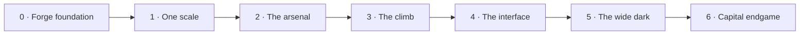

# Black Current: the master plan

The one plan for every AI seat and every human working on this repo: a single
route, worked top-down. Read it before you start; update it before you stop.

## The master route (2026-10-28)

The central loop is **build → fight → recover something useful → refit → choose
a harder destination**. Mac owns design, direction, the phone/fun verdict and
release decisions. This is the **only** game plan: one route, worked top-down,
from the published rc.13 to the capital endgame. Stages are a sequence, not
dates. The table is what `scripts/render-roadmap.py` draws; the stage notes
below it are the working list.

| Stage | Outcome | Done when |
| --- | --- | --- |
| 0. Forge foundation | One tuning file and an unlocked core | `js/tuning.js` holds every size, sector, gun-curve and economy number. The six core files are edited directly under a fast `npm run test:core`. The opening still plays the same. |
| 1. One scale | Ships, enemies and zones share one size ladder | Each class matches enemy to player within ±15% in length. A titan is about half the screen. Sectors grow by band. Hull mass slows big ships. Fleets spawn in formation with no overlap. |
| 2. The arsenal | About 30 guns, each with a reason to exist | No gun leads its whole class on every measure. Damage rises about 1.8× per class and price about 3–4×. The signature guns are the best at their job. Player shields and repair scale with frame. Old ids migrate. |
| 3. The climb | A fair path from frigate to titan | A simulated progression census reaches each frame within Mac's target hours. Bounties and drops scale by band. Loot sources are clear. |
| 4. The interface | A clean HUD and compact menus | The HUD changes with context. Rookie prompts expire. There is one danger label. The title, chart and quick-launch bugs are fixed. A phone pass is done. |
| 5. The wide dark | Bigger, stranger space worth exploring | Grids grow to 15–19. There are safe, contested and null bands up to tier 20. There are anomalies, derelicts and hidden systems, and sector jobs beyond clear and boss. |
| 6. Capital endgame | Citadels, warlords and titan fleets | At least one citadel and one roaming warlord exist, with breakable shields, batteries and core, plus specific rewards. The four home bosses are rescaled. |

### Why this order

Measured on rc.13 (2026-10-28):
- **Zones too small.** A sector is 5,200–6,400 px across, while a titan is 800 px and an enemy flagship about 1,200 px. At 40% zoom, one screen is half a sector.
- **Sizes don't match.** Enemy art is scaled up to 4.5× (`js/hostile-skins.js`), so enemies are bigger than player ships of the same class. Deep fleets spawn overlapping. Movement has no mass, so a titan handles like a frigate.
- **Guns.** 78 of the 93 guns are the same 15 types cloned into each class. Flak has the top damage in every class and Lance the lowest. Railgun, lance and cluster are weaker than generated guns in their own class.
- **Price wall.** Capital guns cost about 110k, 10× the siege price, for 1.85× the damage.
- **Endgame.** A fitted titan costs about 2M metal against 1,500 metal per tier-10 kill. Player shields don't scale: a titan had 90 shield; the tier-10 enemy has 22,000.

Scale comes first because every later number (range, damage, price, sector content) is tuned against it. Doing balance before scale means doing it twice.

### Decisions in force (Mac approved, 2026-10-28)

1. **The six core files are unlocked.** `engine.js`, `hardpoints.js`, `fleet.js`, `weapons.js`, `progression.js` and `shipyard-ui.js` may be edited directly. Behaviour witnesses replace their byte-hash gates.
2. **About 30 curated guns** are offered instead of 93 (all 16 Point starters, 25 roster guns, 3 specials). Retired guns already owned keep flying; nothing is taken from a save, so no refund is due. Enemies and salvage use the roster gun of the same class and family.
3. **Migrate saves; never reset them.** Blueprints, metal and progress survive every stage.
4. **A titan fills about 40% of the screen at the default zoom.** The camera pulls back with hull class, and sectors grow with danger band (Mac's framing verdict decides the final ladder in `js/tuning.js`).
5. **Use `art/` first** (see Art library) before commissioning anything new. Antigravity keeps the module/cosmetic art lane.

### Stage 6 · Capital endgame
- **Citadel fortress.** Separate shield, battery, hangar and core objectives. Art: `armor/citadel_slab`, `precursor_blocks/solar_citadel`, `precursor_blocks/obsidian_keel`.
- **Warlords and titan fleets.** Six roaming warlords with canon names (`docs/canon/`), and titan fleets in the null band.
- **Rescaled bosses.** The four home bosses and the Grave Choir move onto the new ladder.
- **Rewards.** Earnable capital guns and unique titan fittings. Titan services must exist before a titan is called a mobile base.

### After the route (parked, not deleted)
- **AI escorts, then private co-op.** Useful AI escort roles first, then the private two-player arena (proposal below).
- **More sector jobs.** Escort, station defence and courier jobs (Stage 5 shipped salvage and anomaly jobs).
- **Hull specialisation paths.** Five or eight per frame; decide before building.
- **Optional mechanics.** Damage-type multipliers, adjacency bonuses, a volatile hold and a fitting-reduction preview. Never add these by implication.
- **Mining and industry.** Only if players ask.

### Co-op proposal — design only

- First slice: private two-player room, one arena, existing ships, one shared
  guardian, friendly fire off, personal loot and a simple revive. Four players
  is a later expansion, after frame/network measurements.
- Join flow: create room → share code → ready check → enter together → fight →
  leave with an explicit result. No public matchmaking or voice/chat is needed
  for this first slice.
- Proposed authority: a room service owns enemies, damage, pickups and reward
  claims; clients send input and display snapshots. This needs a technical
  spike: the present runtime has one global player and player/enemy bullet
  ownership. It is not already a network engine.
- Architecture gate: separate simulation from presentation, add player/team IDs,
  validate imported designs, and define reconnect and room-ending behaviour.
  Prototype persistent rewards only after duplicate-claim and dropped-connection
  cases pass. Room hosting, stack, cost and delivery time are still undecided.
- Persistent shared galaxy, trading and PvP stay outside the first prototype.
  This proposal authorises planning, not deployment of a multiplayer backend.

### What makes the game worth returning to

Visible ship growth, distinct fights, understandable next upgrades, memorable
places and a friend to share them with. A good trailer should show actual
building, actual combat and one striking guardian scene. Judge the first release
by playability and those concrete moments; commercial reach remains unproven.

## Rules (every seat follows these)

1. **Follow Mac’s latest direction.** Work the route in stage order; keep each build batch bounded.
2. **One plan.** This file is the master route. Dated docs (`PLAN_WEEKEND_BLITZ_*`, `HANDOFF_*`, `docs/research/*`)
   are history and sources, not plans (`PLAN_2026-08-17.md` and `PLAN_FPS_AND_FUN_2026-10-23.md` included). If you find a second to-do list, merge it here and say so in your commit.
3. **Delete finished work.** When an item is done, delete it from this file in the same commit that lands it.
   The receipt lives in the commit message, not here. Done items do not stay as ✅ lines.
4. **Done means witnessed.** You can delete an item only when the thing works in the running game (a screenshot
   or a witness script) and `npm test` is no worse than before. A green test alone is not done. Phone feel and fun
   are Mac's call. Mark phone-unchecked work `PHONE: pending`.
5. **Delete dead ideas too.** If Mac rejects an item, or the evidence kills it, delete it and put one line of
   why in the commit message.
6. **Keep it short.** Each item gets a name, what done looks like, and where it touches the code. No essays.
   Detail goes in code comments or a handoff.
7. **Order is priority.** Work top-down unless Mac says otherwise. Mac can reorder at any time.
8. **Claims carry a label.** Line counts and effort guesses are guesses (UNVERIFIED) until someone builds them.
9. **Laws still apply.** README §Laws, `GAME_VISION.md`, `CLAUDE.md`. Classic scripts only, guard with `typeof X`.
   The six core files (`engine.js`, `hardpoints.js`, `fleet.js`, `weapons.js`, `progression.js`, `shipyard-ui.js`)
   may be edited directly from Stage 0 on; behaviour witnesses, not byte hashes, protect them.
10. **Keep live tasks current.** Update the table below at build milestones. Only one task is running; queued,
    blocked and awaiting Mac's test are distinct. Done carries evidence. The local task viewer reads this file,
    so never create a second progress database or mark planned work as completed.

## Live tasks

The live viewer reads the local working copy. A GitHub commit is a timestamped
snapshot of this table, not an automatic activity feed.

<!-- live-tasks:start -->
Project: Black Current
Published: rc.13 · Threat ladder · live on Pages
Candidate: none · branch claude/keen-feynman-p4adh0 carries Stages 0–5 (not published)
Focus: Stage 6 · Capital endgame is running. Stages 0–5 await Mac's play; rc.13 phone verdict still open.
Updated: 2026-10-28T21:30:00+00:00

| ID | Status | Task | Evidence / next step |
| --- | --- | --- | --- |
| stage-0-foundation | review | Unlock the core, add `js/tuning.js`, add `test:core`, finish the regression baseline | Landed 6750b5c. Hash gates retired; `js/tuning.js` holds live numbers; `npm run test:core`/`test:all`. Baseline vs untouched rc.13: 48 witnesses, 17 green; every other failure reproduces on rc.13 (stale fixtures/UI ids, old weapon counts). Chromium-only run here; Firefox not installed. |
| stage-1-scale | review | One size ladder for ships, enemies and zones | Landed db4a8da. `witness-one-scale` 10/10: titan 1,814 px, enemies ±12% of class, danger-10 rooms 9,000 px, titan ~41% of screen, 0.50× speed / 0.36× turn, 0 spawn overlaps. 11/11 green witnesses unchanged. Mac: play big hulls, judge framing and pace. PHONE: pending. |
| stage-2-arsenal | review | About 30 curated guns; curves; shields; save migration | `witness-arsenal` 14/14; census in `docs/research/ARSENAL_CENSUS_2026-10-28.csv`. One gun per family per class Light→Capital; lanes (beam ×1.5 vs shields, rail ×1.3 vs hull) measured on real hits; DPS ×1.75–2.0 and price ×3.4–3.8 per class; titan shield 6,300 (was 90). Owned retired guns still fly. Mac: try beams vs shielded fleets. PHONE: pending. |
| stage-3-climb | review | Fair frigate → titan economy and useful loot | `witness-climb` 7/7. Measured kill times + modelled pace (2.5× kill time + 25 s travel, `tuning.CLIMB`): frigate → titan 17.6 h in steps 1.1/2.0/3.5/5.0/6.0 h (was 59 h with a 16 h cruiser→battleship wall). Frames/training re-priced, mid-tier bounties raised. Deep wrecks now drop the band's own roster guns (capital at tier 8, was Light); ~5 loose parts and ~7–10 cores per 100 kills. Biomass gates unmodelled. Mac: set the target hours by playing. |
| stage-4-interface | review | Contextual HUD, compact menus, title fixes, phone pass | `witness-interface` 10/10 with desktop/phone captures. One danger number (strip: sector danger, system in brackets); home-only expedition prompt hides elsewhere; `body.bc-combat` folds contract rows and dims view controls; chart blocked over title; solid one-row launch footer; `?forge-test` quick launch works (grant after launch); phone dock prompt no longer covers doctrine buttons. Existing: phone-layout Ability reachability fails as on rc.13. PHONE: pending on Mac's device. |
| stage-5-wide-dark | review | Bigger grids, danger bands to 20, anomalies, sector jobs | `witness-wide-dark` 10/10. Home 19×19, systems 15–19 wide (inner coordinates/seeds unchanged). Bands: safe 1–3, contested 4–10, null 11–20 (far regions +3/+6); threat rows extended to 20 (tier 20: 654k HP, 9,300 metal); null fleets = titan flagship, tier-18 escorts, capital screens; rooms to 12,000 px. Derelicts (guarded; salvage = band-class roster gun + metal), anomalies (relic fitting + a far system charted), GRAVEYARD rule by hash (no rolled rule moved), salvage/anomaly contracts. Escort, station-defence and courier jobs not built (see After the route). PHONE: pending. |
| stage-6-capital | running | Citadels, warlords, titan fleets, rescaled bosses | One citadel and one warlord playable with breakable objectives and rewards. |
| phone-verdict | review | Judge rc.13 on actual hardware | Rc.13 live: source ef975d7, Pages 939cf45, cache 20261028s68. Phone FPS, comfort and coordinated fights unverified. |
<!-- live-tasks:end -->

## Art library (`art/`, use before commissioning)

| Folder | Holds | Live now | Stage |
| --- | --- | --- | --- |
| `keyed/modules/`, `sliced/modules/` | 215 module and turret pieces (`manifest.json`) | Fitting art | 2, 4 |
| `keyed/sections/` | 10 modular hull tiles | Player hulls | 1 |
| `keyed/ships/`, `sliced/ships/` | 36 whole-ship sprites, Asterion and alien/precursor | Partly | 1 (enemy pools) |
| `keyed/enemy-ships/` | 17 enemy hulls | Partly | 1 |
| `keyed/hostiles/` | Hostile fleet sheet (`hostile-kit.json`) | Enemy skins | 1 |
| `keyed/turrets/`, `light_guns/`, `heavy_guns/` | Turret and gun art | Partly | 2 |
| `keyed/precursor_weapons/`, `alien_weapons/` | Solar lance, tachyon driver, bio dart, spore mortar | Not yet | 2 |
| `keyed/alien_blocks/`, `precursor_blocks/`, `armor/` | Carapace, heart, rib cage, keel, solar citadel, citadel slab | Not yet | 5, 6 |
| `keyed/structures/`, `keyed/world/` | Refit station, solar ring | Stations, boss arena | 5 |
| `concepts/`, `contact_*.png` | Concept sheets and contact sheets | Reference | — |

`faction-kit.json`, `hostile-kit.json` and `world-kit.json` select assets for the game.
Incoming art stays preserved; accepted pieces get manifest rows.

## Deploy (main is NOT the live site)
GitHub Pages serves the **`gh-pages`** branch, not `main`. Pushing `main` changes nothing Mac can see.
Prepare the selected-source candidate with `python3 scripts/build-candidate.py`.
This includes tracked assets and referenced JS/CSS from the working tree while
excluding unselected incoming art. Review `shots/release-candidate/package.json`
and run `npm run test:candidate` with muted audio before a release decision.
To publish that reviewed candidate: copy `dist/release-candidate/` over a `gh-pages` worktree → commit
"Publish ..." → push `gh-pages` → wait for `gh api repos/Lycheetah/black-current/pages/builds/latest` to say
`built` → check the live `play/` page shows the new `v=` cache token. Publish only on Mac's word.

## Standing rulings from Mac
- **Modular stays (latest):** use the original large node ships as silhouette references for modular capitals. Decompose bridge, keel, bow, armour, engines, hangars and batteries into coherent top-down parts. Weapon access and phone blockers come first; any later living uniques share the existing hangar/save infrastructure.
- **Latest playtest (2026-10-26):** opening sectors 0,2 and 0,3 must be beatable with a three-gun rookie; expand normal sector grids by three rings. Enemy roles must look different. Reduce excessive equipment drops and check actual weapon DPS. Keep entry fitting obvious; premades are valuable.
- **Current opening/refit ruling (2026-10-26):** build-first, premades optional; starter frigates have ten sections, two supplied guns and a four-weapon cap. Ordinary weapons use one hardware price. Owned fittings may be swapped in the field; new purchases and structural rebuilding use stations. Retire obsolete vow overlays and favour polishing existing systems. Show Metal and Biomass together.
- **Latest ruling:** retire the old freeform fitting screen; modular is the visible fitting screen. Reset old development campaigns once for the new novice fleet (Mac, current session).
- **"Modular ships is the way"** (Mac, 2026-10-25): modular is where new depth and art go first.
- Test a build free with **Test flight · free** (modular yard) or **HOLO TEST · free** (classic yard, desktop).
- Test any build with `?forge-test` (gives 999,999 metal).

## Canon (Mac's Sovereign Eclipse lore, the game's own lineage)
`docs/canon/` holds Mac's canon: the **Master Canon Bible** (canonical; it contains the full Pantheon Codex),
the **15-civilisation Pantheon** and the **270 faction hulls**. `js/canon.js` is the same canon as game data:
15 civilisations (doctrine, fleet DNA, favoured weapon, relic, frontier), the 18-class ladder
Pod → Starter Frigate → … → Dreadnought → Carrier → Titan, 270 hull names, and the Five Depths
(Naraka · Erebos · Aion · Chaos Cradle · Deep Current). Canon wins naming disputes. New factions, enemies,
stations and hulls take their names and look from it.

## North star (Mac, 2026-10-25)
"Focus on making the main game fucking epic": ships buildable to **capital proportions**, **bases** you build,
**many kinds of enemies**, a **deep space with anomalies**, and **EVE-like quests and bounties with NPCs to talk
to**. Mining and industry are parked: build them only if players ask for them.

## Sources
- `docs/canon/`: Mac's Sovereign Eclipse canon (see Canon above). `js/canon.js` is its data form.
- `docs/research/RETENTION_DOSSIER_FOR_SOL_OPUS.md`: a Gemini research pass on Starsector, Space Rangers 2,
  Cosmoteer, Dredge and EVE (historical design input; its line counts are UNVERIFIED).
- `HANDOFF_2026-10-25_menus_loot.md`: local only, the session receipts behind the top-down hulls and clip-ons.
