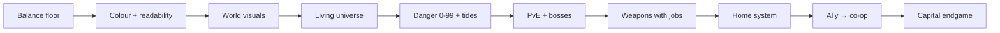

# Black Current: the living plan

The one backlog for every AI seat and every human working on this repo. Read it before you start; update it
before you stop.

## Master plan — 2026-10-30

**Black Current is an epic ship battle simulator:** build a ship from real parts, fight fleets that look and
behave differently, carry salvage home, and grow from a two-gun frigate to a home system worth defending.
Mac owns design, direction, the phone/fun verdict and release decisions.

**How we work.** Small batches that Mac can feel in one play session. Prove each change with real captures and
the existing witnesses run before and after; do not add a new test file per fix. One reusable look at the game:
`npm run scan:visual` (40 desktop/phone captures plus a galaxy danger census in `shots/visual-scan/`).

| Phase | Outcome | Done when |
| --- | --- | --- |
| 1. Balance floor | Wings, rooms and the danger map make sense | Wing fix published; danger ownership in one place; a smoother HP ladder; a galaxy where early space is not 4% of sectors |
| 2. Colour and readability | Ships, enemies, shots and world stop blending | A written colour language (player, hostile, neutral, loot, danger) applied to hulls, HUD and projectiles; Mac's phone verdict |
| 3. World that looks like Black Current | Places, not circles | A backdrop per Depth, painted or shaded landmarks, gates and stations, quieter labels, decluttered HUD |
| 4. Living universe | Space has traffic, law and consequence | Gates, Warden patrols in safe space, traders and pirates moving between systems, visible security on the chart |
| 5. Danger 0–99 and Current tides | Risk you can read and that moves | Outer rings carry the highest danger; tides shift system danger on a cycle and show it on the chart |
| 6. PvE variety and bosses | Fights with different jobs | Objective encounters, elite affixes, contested faction zones; real arenas and scale for Titan, Queen and Leviathan |
| 7. Weapons with jobs | Choosing a gun matters | Damage layers against shields/armour/swarms, enemy profiles, traits on recovered guns |
| 8. Home system | Your elite base | Claim and build up a whole system: stations, defences, a shipyard, raids to repel; later, conquest of more |
| 9. Ally → co-op | A friend in the fight | AI escort roles first; private two-player room later (see co-op proposal) |
| 10. Capital endgame | Titan fleets and citadels | Authored shields, batteries, hangars and cores with specific rewards |

**Published:** 2.11.0-rc.13 Threat ladder (cache `20261028s68`). **On branch, not published:** real ships in
the fitting screen, new campaign with full browser storage, roaming wings on the fleet ladder.

## What the 2026-10-30 scan found

- **Visual:** the same black hole sits in every sector, system and three of four boss fights; regions differ
  only by tint; landmarks, gates and wrecks are primitive shapes; Titan/Queen/Leviathan have no arena and render
  smaller than tier-5 enemies; landmark labels clutter play; desktop and phone HUD take a large share of the
  screen; ship colours sink into the dark background. The Solar Dreadnought arena shows the target quality.
- **PvE:** 4% of 13,067 sectors are danger 1–3, 31% are 4–6 and 65% are 7–10. Deep rooms are one flagship plus
  nine near-trivial screens. Starter: 140 HP, 68 DPS. Roaming wings at danger 7–10 were 4–6x the room
  they joined (fixed on branch). Every fight has the same shape: arrive, clear, a wing warps in.

## Design pillars (Mac's direction, 2026-10-30)

Proposals until built; names follow canon and Mac confirms them.

- **Colour language.** Player hulls carry their paint and a bright team rim; hostiles a warm rim; neutrals
  and Wardens their own hue; loot gold; danger red–violet. Hull art keeps its materials but gains contrast
  against the background. Applies to shots and HUD too.
- **World visuals.** One backdrop and palette per Depth (Naraka, Erebos, Aion, Chaos Cradle, Deep Current);
  shaded asteroid fields that block shots; wrecks built from real hull art; real gates and stations; Track-1
  painted assets from Mac/Antigravity drop in through `art/world-kit.json`.
- **Living universe.** Jump gates between systems. **Wardens** (working name; canon has the Chaos *Prism Warden*
  and *Sentinel* guardian warships) patrol safe space, answer piracy and ignore the null frontier. Traders,
  convoys and pirate raiders travel the lanes; factions fight in contested zones; the chart shows security.
- **Danger 0–99 and Current tides.** Home and inner rings stay safe; three outer rings per system carry the
  highest danger. A tide cycle shifts some systems' danger up or down; the chart shows the change as it
  happens and warns before a jump. Higher bands add roles, objectives and rewards, not only HP.
- **Home system.** The player claims a system and builds it into an elite base (existing structures and raids
  are the seed). It should feel homely; conquering more systems is the long road.
- **PvE variety.** Escort, defend-the-scan, blockade, named bounty, fortified outpost with shield pylons,
  disable-for-loot; elite affixes (shielded, splitting, reflecting, cloaked); warned raids on your structures.
- **Weapons with jobs.** Beam strips shields, kinetic breaks hull, rail snipes parts, missile hits big ships,
  ordnance clears swarms; faction profiles make you refit; recovered guns carry traits.

## Rules (every seat follows these)

1. **Follow Mac’s latest direction.** Work the backlog in priority order; keep each build batch bounded.
2. **One plan.** This file is the backlog. Dated docs (`PLAN_WEEKEND_BLITZ_*`, `HANDOFF_*`, `docs/research/*`)
   are history and sources, not plans (`PLAN_2026-08-17.md` and `PLAN_FPS_AND_FUN_2026-10-23.md` included). If you find a second to-do list, merge it here and say so in your commit.
3. **Delete finished work.** When an item is done, delete it from this file in the same commit that lands it.
   The receipt lives in the commit message, not here. Done items do not stay as ✅ lines.
4. **Done means witnessed.** You can delete an item only when the thing works in the running game (a screenshot
   or a witness script) and `npm test` is no worse than before. A green test alone is not done. Phone feel and fun
   are Mac's call. Mark phone-unchecked work `PHONE: pending`.
5. **Delete dead ideas too.** If Mac rejects an item, or the evidence kills it, delete it and put one line of
   why in the commit message.
6. **Keep it short.** Each item gets a name, what done looks like, and where it touches the code. No essays.
   Detail goes in code comments or a handoff.
7. **Order is priority.** Work top-down unless Mac says otherwise. Mac can reorder at any time.
8. **Claims carry a label.** Line counts and effort guesses are guesses (UNVERIFIED) until someone builds them.
9. **Laws still apply.** README §Laws, `GAME_VISION.md`, `CLAUDE.md`. Classic scripts only, guard with `typeof X`,
   never break the source-hash gates (`weapons.js` and the other original gun files stay byte-identical; patch them
   from another file).
10. **Keep live tasks current.** Update the table below at build milestones. Only one task is running; queued,
    blocked and awaiting Mac's test are distinct. Done carries evidence. The local task viewer reads this file,
    so never create a second progress database or mark planned work as completed.

## Live tasks

The live viewer reads the local working copy. A GitHub commit is a timestamped
snapshot of this table, not an automatic activity feed.

<!-- live-tasks:start -->
Project: Black Current
Published: rc.13 · Threat ladder · live on Pages
Candidate: none · three fixes on `claude/laughing-edison-rc6tl5`, unpublished
Focus: Master plan set. Next: one danger owner, smoother ladder and galaxy danger map; then the colour language.
Updated: 2026-10-30T12:00:00+00:00

| ID | Status | Task | Evidence / next step |
| --- | --- | --- | --- |
| fitting-display | review | Real ships in the fitting screen | Doubled slip render removed; frame cards show example ships. Desktop and 390px captures; hangar/phone-fitting witnesses match baseline. Mac to judge the slip on phone. |
| storage-reset | review | New campaign when browser storage is full | Filled-storage test: accept downloads the old campaign and boots the new one; decline keeps the old one. Needs publish and Mac's retry. |
| wing-ladder | review | Roaming wings follow the fleet ladder | Danger-10 wing 1.39M → 306k HP against a 278k room. Scaling witness 22/22 before and after. |
| danger-floor | queued | One danger owner, smoother ladder, galaxy danger map | Today four files write `dangerLevel`; HP steps x2.4–2.8 at tiers 5 and 7; 65% of sectors are danger 7+. |
| colour-language | queued | Make ships, enemies, shots and world readable | Written palette first, then hulls/rims, projectiles, HUD; before/after scan. |
| world-visuals | queued | Backdrops per Depth and real landmarks | Replace the global black hole; asteroids, wrecks, gates, stations; prompt sheet for painted assets. |
| boss-arenas | queued | Titan, Queen, Leviathan arenas and scale | Follow the Solar Dreadnought scene. |
| living-universe | queued | Gates, Wardens, traffic, security on the chart | Design pass with Mac before building. |
| danger-tides | queued | Danger 0–99 outer rings and Current tides | Needs danger-floor first. |
| pve-variety | queued | Objective encounters, elite affixes, contested zones | After danger-floor. |
| weapon-jobs | queued | Damage layers, enemy profiles, loot traits | After PvE variety. |
| home-system | queued | Claim and build a system as your base | Builds on existing structures and raids. |
| phone-verdict | review | Judge current release on actual hardware | Rc.13 plus the three branch fixes once published. |
| regression-debt | queued | Bring the existing witnesses back to green | Chromium runs today: hangar-ui 33/34, phone-fitting 6/7, workshop-reset 8/12 fail identically before and after; fixtures need updating, not new suites. |
<!-- live-tasks:end -->

## Deploy (main is NOT the live site)
GitHub Pages serves the **`gh-pages`** branch, not `main`. Pushing `main` changes nothing Mac can see.
Prepare the selected-source candidate with `python3 scripts/build-candidate.py`.
This includes tracked assets and referenced JS/CSS from the working tree while
excluding unselected incoming art. Review `shots/release-candidate/package.json`
and run `npm run test:candidate` with muted audio before a release decision.
To publish that reviewed candidate: copy `dist/release-candidate/` over a `gh-pages` worktree → commit
"Publish ..." → push `gh-pages` → wait for `gh api repos/Lycheetah/black-current/pages/builds/latest` to say
`built` → check the live `play/` page shows the new `v=` cache token. Publish only on Mac's word.

## Standing rulings from Mac
- **Modular stays (latest):** use the original large node ships as silhouette references for modular capitals. Decompose bridge, keel, bow, armour, engines, hangars and batteries into coherent top-down parts. Weapon access and phone blockers come first; any later living uniques share the existing hangar/save infrastructure.
- **Latest playtest (2026-10-26):** opening sectors 0,2 and 0,3 must be beatable with a three-gun rookie; expand normal sector grids by three rings. Enemy roles must look different. Reduce excessive equipment drops and check actual weapon DPS. Keep entry fitting obvious; premades are valuable.
- **Current opening/refit ruling (2026-10-26):** build-first, premades optional; starter frigates have ten sections, two supplied guns and a four-weapon cap. Ordinary weapons use one hardware price. Owned fittings may be swapped in the field; new purchases and structural rebuilding use stations. Retire obsolete vow overlays and favour polishing existing systems. Show Metal and Biomass together.
- **Latest ruling:** retire the old freeform fitting screen; modular is the visible fitting screen. Reset old development campaigns once for the new novice fleet (Mac, current session).
- **"Modular ships is the way"** (Mac, 2026-10-25): modular is where new depth and art go first.
- Test a build free with **Test flight · free** (modular yard) or **HOLO TEST · free** (classic yard, desktop).
- Test any build with `?forge-test` (gives 999,999 metal).

## Canon (Mac's Sovereign Eclipse lore, the game's own lineage)
`docs/canon/` holds Mac's canon: the **Master Canon Bible** (canonical; it contains the full Pantheon Codex),
the **15-civilisation Pantheon** and the **270 faction hulls**. `js/canon.js` is the same canon as game data:
15 civilisations (doctrine, fleet DNA, favoured weapon, relic, frontier), the 18-class ladder
Pod → Starter Frigate → … → Dreadnought → Carrier → Titan, 270 hull names, and the Five Depths
(Naraka · Erebos · Aion · Chaos Cradle · Deep Current). Canon wins naming disputes. New factions, enemies,
stations and hulls take their names and look from it.

## North star (Mac, 2026-10-25)
"Focus on making the main game fucking epic": ships buildable to **capital proportions**, **bases** you build,
**many kinds of enemies**, a **deep space with anomalies**, and **EVE-like quests and bounties with NPCs to talk
to**. Mining and industry are parked: build them only if players ask for them.
**2026-10-30:** "an epic ship battle simulator"; a world that looks the part; danger you can see shift; a
universe with law and traffic; a whole system as your home base. Lean code and lean tests: no 36k test lines
for every 5k of game.

## Co-op proposal — design only

- First slice: private two-player room, one arena, existing ships, one shared
  guardian, friendly fire off, personal loot and a simple revive. Four players
  is a later expansion, after frame/network measurements.
- Join flow: create room → share code → ready check → enter together → fight →
  leave with an explicit result. No public matchmaking or voice/chat is needed
  for this first slice.
- Proposed authority: a room service owns enemies, damage, pickups and reward
  claims; clients send input and display snapshots. This needs a technical
  spike: the present runtime has one global player and player/enemy bullet
  ownership. It is not already a network engine.
- Architecture gate: separate simulation from presentation, add player/team IDs,
  validate imported designs, and define reconnect and room-ending behaviour.
  Prototype persistent rewards only after duplicate-claim and dropped-connection
  cases pass. Room hosting, stack, cost and delivery time are still undecided.
- Persistent shared galaxy, trading and PvP stay outside the first prototype.
  This proposal authorises planning, not deployment of a multiplayer backend.

## Continuation list (top = next)

1. **Danger floor.** Make `combat-scaling.js` the single writer of `dangerLevel` (today `map.js`,
   `pve-frontier.js`, `combat-scaling.js` and spawners each set it). Smooth the HP ladder (about x1.6 per tier)
   against weapon class DPS. Reshape system danger so roughly a quarter of sectors are 1–3. Witness with the scan census and `test:scaling`.
2. **Colour language.** Palette doc, then hull rim/paint contrast, hostile rims, projectile colours by owner, HUD
   tokens. Sources: `topdown-kit.js`, `section-art.js`, `faction-fleets.js`, `combat-feel.js`, `css/`.
3. **World visuals.** Per-Depth backdrop (replace the screen-fixed black hole), shaded asteroid fields, wrecks from
   accepted hull art, gates and stations, label declutter, HUD trim. Prompt sheet for painted assets.
   Sources: `sectors.js`, `atmosphere.js`, `shaders.js`, `galaxy.js`, `art/world-kit.json`.
4. **Boss arenas and scale** for Abyssal Titan, Hive Queen and Void Leviathan; fix the boss bar overlapping the
   wallet. Sources: `boss-scenes.js`, `bosses.js`.
5. **Living universe.** Gates, Warden patrols and response, lane traffic, security level on the chart.
6. **Danger 0–99 and Current tides** on top of the danger floor; three outer rings per system; tide cycle visible on the chart.
7. **PvE variety:** objective encounters, elite affixes, contested faction zones, warned raids.
8. **Weapons with jobs:** damage layers, enemy profiles, loot traits; preserve the six protected sources.
9. **Home system:** claim, build, defend; conquest later.
10. **Fitting screen polish:** colour contrast on the slip, desktop side panel without long scroll, phone flow.
11. **Ally → co-op**, then **capital endgame** (see co-op proposal and phase table).
12. **Sound and feedback** from Mac's listening verdict. Hull specialisation paths still need Mac's 5-vs-8 decision.

## Sources
- `docs/canon/`: Mac's Sovereign Eclipse canon (see Canon above). `js/canon.js` is its data form.
- `docs/research/RETENTION_DOSSIER_FOR_SOL_OPUS.md`: a Gemini research pass on Starsector, Space Rangers 2,
  Cosmoteer, Dredge and EVE (historical design input; its line counts are UNVERIFIED).
- `HANDOFF_2026-10-25_menus_loot.md`: local only, the session receipts behind the top-down hulls and clip-ons.
