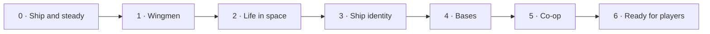

# Black Current: the master plan

The one plan for every AI seat and every human working on this repo: a single
route, worked top-down. Read it before you start; update it before you stop.

## The master route · Route 2 "The living current" (2026-10-29)

The central loop is still **build → fight → recover something useful → refit → choose
a harder destination**. Route 1 (scale, arsenal, climb, interface, wide dark, capital
endgame) shipped as **2.12.0-rc.14**. Its receipts live in the CHANGELOG and git history.
Route 2 makes the Current feel **alive and shared**: allies, people with jobs, ships with
identity, a home you build, a friend in the fight, and a release strangers can pick up.

Mac owns design, direction, the phone/fun verdict and release decisions. This is the
**only** game plan: one route, worked top-down. **Every stage ends in a publishable
candidate.** We publish small drops (one per stage or two) on Mac's word, so feedback
stays fresh. The table is what `scripts/render-roadmap.py` draws; the stage notes below
are the working list.

| Stage | Outcome | Done when |
| --- | --- | --- |
| 0. Ship and steady | rc.14 live, tests on every PR, a suite you can trust | rc.14 is on Pages. A PR workflow runs the core and route witnesses. The full suite is ≥ 90% green, with every remaining red named as a Mac-device check. The biggest measured cost in a titan fight is fixed. |
| 1. Wingmen | AI escorts built from your own ships | Hire 1–3 wingmen from saved designs, up to your frame class. Orders: follow, attack my target, hold, guard. Roles: gunship, mender, carrier. They save, die and are rebuilt at stations. Ships and shots carry owner/team ids. |
| 2. Life in space | People with jobs, and reputation | Canon contacts at stations offer escort, station-defence, courier and bounty jobs with map routes. Reputation per civilisation opens stock, commissions and liveries. Stations differ by faction. |
| 3. Ship identity | Five hull paths and civilisation signatures | Every frame offers interceptor, assault, logistics, carrier or siege, with clear trade-offs from `js/tuning.js`. Each civilisation has signature liveries and clip-ons. Selected module art from Antigravity's lane is in flight and in the yard. |
| 4. Bases | A home you build, and the titan as a mobile base | Structures grow into a base: refinery, shipyard berth, wingman hangar, defence grid, with raid warnings. A titan can refit, repair and relaunch wingmen in the field. |
| 5. Co-op | Two friends, one fight | Room code → peer-to-peer WebRTC, with the host's browser running the fight. One shared guardian arena, friendly fire off, personal loot, revive, and a safe leave or reconnect, proven across two networks. |
| 6. Ready for players | v3.0 for strangers | Onboarding covers the new systems. Mac's phone pass is done. Trailer captured. itch.io page with the standalone download. 3.0.0 published. |

### Why this order

- **Trust first.** 31 of 54 witnesses are red, mostly stale, so the suite can't yet say "nothing broke". Small drops need a suite and CI that mean something.
- **Wingmen before co-op.** Giving ships owner/team ids, and letting more than one friendly ship fight beside you, is half the co-op refactor. It is also fun on its own, solo.
- **Life before bases.** Jobs, contacts and reputation are what give a base a reason to exist and a reason to be raided.
- **Identity before bases.** Hull paths decide what a base's berth and hangar build and hold.
- **Co-op late but not last.** It reuses wingmen (team ids), bases (a shared home later) and the guardian arenas. It needs the networking spike and a connection decision, which was made below.
- **Ready for players last.** Onboarding, trailer and store page describe a finished feature set.

### Decisions in force

Still in force from Route 1:
1. The six core files are open to edit, under behaviour witnesses.
2. Saves are migrated, never reset.
3. `art/` is used first; Antigravity keeps the module and cosmetic art lane.
4. Threat stays fixed by place and never reads the player's power.

New, Mac, 2026-10-29:
5. **Small drops.** Publish rc.14, then a candidate after every stage or two, on Mac's word.
6. **Five hull paths per frame:** interceptor, assault, logistics, carrier, siege.
7. **Co-op is peer-to-peer and host-authoritative.** The host's browser runs the fight and the guest sends input. No game server.
   - Signalling for the first slice uses a free relay (PeerJS cloud). That is a third-party dependency; Mac confirms it before Stage 5 ships.

### Stage notes (the working list)

**0 · Ship and steady**
- ~~Publish rc.14~~ Done 2026-10-29 (see live tasks).
- **CI:** add `.github/workflows/test.yml` on `pull_request`. It installs Playwright Chromium, serves the repo and runs `node scripts/regression.mjs core one-scale arsenal climb interface wide-dark capital`.
- **Test debt:** work the red witnesses (list in `shots/regression/summary.json`).
  - Update the stale ones: old UI ids, "92 weapons", missing fixtures.
  - Retire witnesses whose subject was removed (freeform editor, workshop), with one line each in the commit.
  - Name the Mac-device-only checks as exceptions.
- **Performance:** profile a danger-20 titan fight with `scripts/profile-fps.mjs` and `js/render-budget.js`. Fix the biggest measured cost. Desktop and phone-viewport numbers recorded; real-device FPS stays Mac's.

**1 · Wingmen**
- Grow `js/roles.js` wing escorts into real modular wingmen:
  - a `wingmen` save doc;
  - designs compiled with `modularShips.compile` and scaled by `tuning.SIZE`;
  - steering from `EnemyOrganism`, but on the player's team.
- Orders on keys 5–8 and phone buttons.
- Owner/team id on ships and projectiles, so hits, kills, loot and contracts attribute correctly.
- Rebuild a lost wingman at stations for metal.
- Witness: `witness-wingmen.mjs`.

**2 · Life in space**
- A contacts board in station services (`js/station-grid.js`), using canon names from `js/canon.js`.
- New contract kinds with routes via `js/travel.js`:
  - escort (a convoy follows a lane);
  - station defence (waves at a public berth);
  - courier (dock at a far station);
  - bounty (a named target).
- Reputation per civilisation opens `quartermaster.js` stock, commissions and liveries.
- Witness: `witness-life.mjs`.

**3 · Ship identity**
- Hull paths are bought from the Shipwright and stored per frame. Each changes a few `tuning` multipliers (mass, shields, slots, hangar count, siege range), shown on frame cards.
- Civilisation signatures through `js/ship-identity.js` and `js/faction-art.js`.
- Module art from `art/review/` → `art/keyed/` with manifests, coordinated with Antigravity.
- Witness: `witness-identity-paths.mjs`.

**4 · Bases**
- Extend `js/hubs.js` KINDS: refinery, berth, hangar, defence grid.
- A base panel: modules, upkeep, raid warnings.
- Titan services: refit and wingman relaunch in the field, gated by a titan-class hangar.
- Witness: `witness-bases.mjs`.

**5 · Co-op**
- Refactor the engine to `engine.players[]`, with `engine.player` kept as the local alias; per-player input and HUD.
- Networking:
  - a WebRTC data channel;
  - the host sends snapshots at about 15 Hz and the guest sends input at 30 Hz.
- First slice (design notes below):
  - one guardian arena;
  - personal loot claimed on the host and written to each player's own save;
  - revive;
  - a 30 s reconnect window.
- Witness: `witness-coop.mjs`, with two browser contexts.

**6 · Ready for players**
- Onboarding cards for lanes, derelicts, citadels, wingmen, paths and co-op.
- Mac's phone pass.
- Trailer from `docs/TRAILER_CAPTURE.md`.
- itch.io page and standalone build.
- 3.0.0, with a changelog entry.

### Parked (not deleted)
- **Persistent shared galaxy, trading, PvP:** only after co-op works.
- **Grave Choir rescale onto the new ladder:** fold into a stage when its excursion is next touched.
- **Optional mechanics:** adjacency bonuses, a volatile hold, a fitting-reduction preview. Never add these by implication.
- **Mining and industry:** only if players ask.

### Co-op design (Stage 5)

- **First slice:** a private two-player room, one arena, existing ships, one shared
  guardian, friendly fire off, personal loot and a simple revive. Four players is a
  later expansion, after frame and network measurements.
- **Join flow:** create room → share code → ready check → enter together → fight →
  leave with an explicit result. No public matchmaking or voice/chat.
- **Authority:** the host's browser simulates enemies, damage, pickups and reward
  claims. The guest sends input and draws snapshots. Each player's own save records
  only their own loot. Duplicate-claim and dropped-connection cases must pass before
  rewards persist.
- **Architecture gate:**
  - separate simulation from presentation;
  - player/team ids (started in Stage 1);
  - validate the guest's imported design;
  - defined reconnect and room-ending behaviour.

### What makes the game worth returning to

Visible ship growth, distinct fights, understandable next upgrades, memorable
places and a friend to share them with. A good trailer should show actual
building, actual combat and one striking guardian scene. Judge the first release
by playability and those concrete moments; commercial reach remains unproven.

## Rules (every seat follows these)

1. **Follow Mac’s latest direction.** Work the route in stage order; keep each build batch bounded.
2. **One plan.** This file is the master route. Dated docs (`PLAN_WEEKEND_BLITZ_*`, `HANDOFF_*`, `docs/research/*`)
   are history and sources, not plans (`PLAN_2026-08-17.md` and `PLAN_FPS_AND_FUN_2026-10-23.md` included). If you find a second to-do list, merge it here and say so in your commit.
3. **Delete finished work.** When an item is done, delete it from this file in the same commit that lands it.
   The receipt lives in the commit message, not here. Done items do not stay as ✅ lines.
4. **Done means witnessed.** You can delete an item only when the thing works in the running game (a screenshot
   or a witness script) and `npm test` is no worse than before. A green test alone is not done. Phone feel and fun
   are Mac's call. Mark phone-unchecked work `PHONE: pending`.
5. **Delete dead ideas too.** If Mac rejects an item, or the evidence kills it, delete it and put one line of
   why in the commit message.
6. **Keep it short.** Each item gets a name, what done looks like, and where it touches the code. No essays.
   Detail goes in code comments or a handoff.
7. **Order is priority.** Work top-down unless Mac says otherwise. Mac can reorder at any time.
8. **Claims carry a label.** Line counts and effort guesses are guesses (UNVERIFIED) until someone builds them.
9. **Laws still apply.** README §Laws, `GAME_VISION.md`, `CLAUDE.md`. Classic scripts only, guard with `typeof X`.
   The six core files (`engine.js`, `hardpoints.js`, `fleet.js`, `weapons.js`, `progression.js`, `shipyard-ui.js`)
   may be edited directly from Stage 0 on; behaviour witnesses, not byte hashes, protect them.
10. **Keep live tasks current.** Update the table below at build milestones. Only one task is running; queued,
    blocked and awaiting Mac's test are distinct. Done carries evidence. The local task viewer reads this file,
    so never create a second progress database or mark planned work as completed.

## Live tasks

The live viewer reads the local working copy. A GitHub commit is a timestamped
snapshot of this table, not an automatic activity feed.

<!-- live-tasks:start -->
Project: Black Current
Published: 2.12.0-rc.14 · Master route (preview) · live on Pages (gh-pages 07870cb, cache 20261028s69)
Candidate: none
Focus: Route 2 · Stage 0 Ship and steady is running (CI, test debt, performance). rc.14 phone and fun verdict is open.
Updated: 2026-10-29T10:00:00+00:00

| ID | Status | Task | Evidence / next step |
| --- | --- | --- | --- |
| stage-0-ship | running | rc.14 live, CI on PRs, ≥ 90% suite, titan-fight performance | rc.14 published: gh-pages 07870cb from source 176a1b3; Pages built in ~45 s; live `play/` shows `v=20261028s69` and "2.12.0-rc.14"; 35/35 changed live files match the package. Package gate 23/24 (the incoming-art check needs Mac's local art). Next: CI workflow, then test debt. |
| stage-1-wingmen | queued | AI escorts built from your ships, plus team ids | Wingmen save doc, orders, roles, rebuild at stations; `witness-wingmen`. |
| stage-2-life | queued | Contacts, jobs, reputation | Escort / defence / courier / bounty with routes; per-civilisation reputation; `witness-life`. |
| stage-3-identity | queued | Five hull paths, civilisation signatures, module art | Paths in `tuning`; liveries/clip-ons; Antigravity art lane; `witness-identity-paths`. |
| stage-4-bases | queued | Base modules, raids, titan services | Refinery / berth / hangar / defence grid; raid warnings; field refit; `witness-bases`. |
| stage-5-coop | queued | Two-player peer-to-peer guardian fight | `engine.players[]`, WebRTC host authority, loot/revive/reconnect; Mac confirms the PeerJS relay first; `witness-coop`. |
| stage-6-players | queued | v3.0 for strangers | Onboarding, phone pass, trailer, itch.io, 3.0.0. |
| rc14-verdict | review | Mac plays rc.14 (desktop and phone) | Live at lycheetah.github.io/black-current/play/. Judge framing, pace, guns, the 17.6 h climb model, menus and FPS. Every number is one line in `js/tuning.js`. |
<!-- live-tasks:end -->

## Art library (`art/`, use before commissioning)

| Folder | Holds | Live now | Stage |
| --- | --- | --- | --- |
| `keyed/modules/`, `sliced/modules/` | 215 module and turret pieces (`manifest.json`) | Fitting art | 2, 4 |
| `keyed/sections/` | 10 modular hull tiles | Player hulls | 1 |
| `keyed/ships/`, `sliced/ships/` | 36 whole-ship sprites, Asterion and alien/precursor | Partly | 1 (enemy pools) |
| `keyed/enemy-ships/` | 17 enemy hulls | Partly | 1 |
| `keyed/hostiles/` | Hostile fleet sheet (`hostile-kit.json`) | Enemy skins | 1 |
| `keyed/turrets/`, `light_guns/`, `heavy_guns/` | Turret and gun art | Partly | 2 |
| `keyed/precursor_weapons/`, `alien_weapons/` | Solar lance, tachyon driver, bio dart, spore mortar | Not yet | 2 |
| `keyed/alien_blocks/`, `precursor_blocks/`, `armor/` | Carapace, heart, rib cage, keel, solar citadel, citadel slab | Not yet | 5, 6 |
| `keyed/structures/`, `keyed/world/` | Refit station, solar ring | Stations, boss arena | 5 |
| `concepts/`, `contact_*.png` | Concept sheets and contact sheets | Reference | — |

`faction-kit.json`, `hostile-kit.json` and `world-kit.json` select assets for the game.
Incoming art stays preserved; accepted pieces get manifest rows.

## Deploy (main is NOT the live site)
GitHub Pages serves the **`gh-pages`** branch, not `main`. Pushing `main` changes nothing Mac can see.
Prepare the selected-source candidate with `python3 scripts/build-candidate.py`.
This includes tracked assets and referenced JS/CSS from the working tree while
excluding unselected incoming art. Review `shots/release-candidate/package.json`
and run `npm run test:candidate` with muted audio before a release decision.
To publish that reviewed candidate: copy `dist/release-candidate/` over a `gh-pages` worktree → commit
"Publish ..." → push `gh-pages` → wait for `gh api repos/Lycheetah/black-current/pages/builds/latest` to say
`built` → check the live `play/` page shows the new `v=` cache token. Publish only on Mac's word.

## Standing rulings from Mac
- **Modular stays (latest):** use the original large node ships as silhouette references for modular capitals. Decompose bridge, keel, bow, armour, engines, hangars and batteries into coherent top-down parts. Weapon access and phone blockers come first; any later living uniques share the existing hangar/save infrastructure.
- **Latest playtest (2026-10-26):** opening sectors 0,2 and 0,3 must be beatable with a three-gun rookie; expand normal sector grids by three rings. Enemy roles must look different. Reduce excessive equipment drops and check actual weapon DPS. Keep entry fitting obvious; premades are valuable.
- **Current opening/refit ruling (2026-10-26):** build-first, premades optional; starter frigates have ten sections, two supplied guns and a four-weapon cap. Ordinary weapons use one hardware price. Owned fittings may be swapped in the field; new purchases and structural rebuilding use stations. Retire obsolete vow overlays and favour polishing existing systems. Show Metal and Biomass together.
- **Latest ruling:** retire the old freeform fitting screen; modular is the visible fitting screen. Reset old development campaigns once for the new novice fleet (Mac, current session).
- **"Modular ships is the way"** (Mac, 2026-10-25): modular is where new depth and art go first.
- Test a build free with **Test flight · free** (modular yard) or **HOLO TEST · free** (classic yard, desktop).
- Test any build with `?forge-test` (gives 999,999 metal).

## Canon (Mac's Sovereign Eclipse lore, the game's own lineage)
`docs/canon/` holds Mac's canon: the **Master Canon Bible** (canonical; it contains the full Pantheon Codex),
the **15-civilisation Pantheon** and the **270 faction hulls**. `js/canon.js` is the same canon as game data:
15 civilisations (doctrine, fleet DNA, favoured weapon, relic, frontier), the 18-class ladder
Pod → Starter Frigate → … → Dreadnought → Carrier → Titan, 270 hull names, and the Five Depths
(Naraka · Erebos · Aion · Chaos Cradle · Deep Current). Canon wins naming disputes. New factions, enemies,
stations and hulls take their names and look from it.

## North star (Mac, 2026-10-25)
"Focus on making the main game fucking epic": ships buildable to **capital proportions**, **bases** you build,
**many kinds of enemies**, a **deep space with anomalies**, and **EVE-like quests and bounties with NPCs to talk
to**. Mining and industry are parked: build them only if players ask for them.

## Sources
- `docs/canon/`: Mac's Sovereign Eclipse canon (see Canon above). `js/canon.js` is its data form.
- `docs/research/RETENTION_DOSSIER_FOR_SOL_OPUS.md`: a Gemini research pass on Starsector, Space Rangers 2,
  Cosmoteer, Dredge and EVE (historical design input; its line counts are UNVERIFIED).
- `HANDOFF_2026-10-25_menus_loot.md`: local only, the session receipts behind the top-down hulls and clip-ons.
